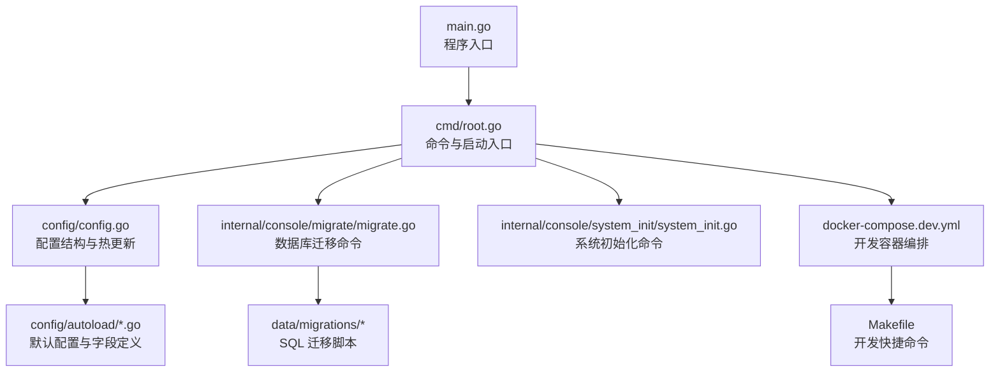
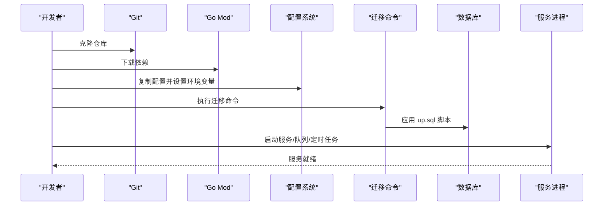

# 快速开始

<cite>
**本文引用的文件**
- [README.md](file://README.md)
- [go.mod](file://go.mod)
- [config/config.yaml.example](file://config/config.yaml.example)
- [main.go](file://main.go)
- [cmd/root.go](file://cmd/root.go)
- [config/config.go](file://config/config.go)
- [config/autoload/app.go](file://config/autoload/app.go)
- [config/autoload/mysql.go](file://config/autoload/mysql.go)
- [config/autoload/redis.go](file://config/autoload/redis.go)
- [data/migrations/20260425000001_init_table.up.sql](file://data/migrations/20260425000001_init_table.up.sql)
- [data/migrations/20260425000002_init_data.up.sql](file://data/migrations/20260425000002_init_data.up.sql)
- [internal/console/migrate/migrate.go](file://internal/console/migrate/migrate.go)
- [internal/console/system_init/system_init.go](file://internal/console/system_init/system_init.go)
- [docker-compose.dev.yml](file://docker-compose.dev.yml)
- [Makefile](file://Makefile)
</cite>

## 目录
1. [简介](#简介)
2. [项目结构](#项目结构)
3. [核心组件](#核心组件)
4. [架构总览](#架构总览)
5. [详细组件分析](#详细组件分析)
6. [依赖分析](#依赖分析)
7. [性能考虑](#性能考虑)
8. [故障排查指南](#故障排查指南)
9. [结论](#结论)
10. [附录](#附录)

## 简介
本指南面向首次接触 gin-layout 的开发者，帮助你在最短时间内完成环境准备、项目克隆、依赖安装、配置与数据库迁移，并成功启动服务。同时提供开发与生产环境的配置要点、常见初始化问题的解决方案以及容器化部署的简化方案。

## 项目结构
gin-layout 采用模块化分层设计，核心分为命令入口、配置系统、数据迁移、业务中间件与控制器等模块。命令入口通过 Cobra 提供多种运行形态（服务、队列消费者、定时任务、CLI 工具），配置系统支持热更新，数据迁移脚本位于 data/migrations。

图表来源
- [main.go:1-10](file://main.go#L1-L10)
- [cmd/root.go:1-101](file://cmd/root.go#L1-L101)
- [config/config.go:1-120](file://config/config.go#L1-L120)
- [config/autoload/app.go:1-81](file://config/autoload/app.go#L1-L81)
- [config/autoload/mysql.go:1-51](file://config/autoload/mysql.go#L1-L51)
- [config/autoload/redis.go:1-45](file://config/autoload/redis.go#L1-L45)
- [internal/console/migrate/migrate.go:1-572](file://internal/console/migrate/migrate.go#L1-L572)
- [internal/console/system_init/system_init.go:1-59](file://internal/console/system_init/system_init.go#L1-L59)
- [docker-compose.dev.yml:1-46](file://docker-compose.dev.yml#L1-L46)
- [Makefile:1-30](file://Makefile#L1-L30)

章节来源
- [README.md:161-194](file://README.md#L161-L194)

## 核心组件
- 命令与启动入口：通过根命令注册服务、队列、定时任务与 CLI 子命令，支持配置文件路径与环境变量加载。
- 配置系统：集中定义应用、MySQL、Redis、日志、JWT、队列等配置项，并支持热更新。
- 数据迁移：提供迁移检查、上/下迁移、版本跳转、强制设置版本等命令，配套 SQL 脚本。
- 开发容器：提供 MySQL、Redis、MinIO 的一键启动与日志查看，便于本地联调。

章节来源
- [cmd/root.go:25-89](file://cmd/root.go#L25-L89)
- [config/config.go:12-120](file://config/config.go#L12-L120)
- [internal/console/migrate/migrate.go:42-172](file://internal/console/migrate/migrate.go#L42-L172)
- [docker-compose.dev.yml:3-46](file://docker-compose.dev.yml#L3-L46)

## 架构总览
下面的时序图展示了从克隆项目到成功启动服务的关键流程，包括配置加载、数据库迁移与服务启动。

图表来源
- [README.md:59-104](file://README.md#L59-L104)
- [internal/console/migrate/migrate.go:266-300](file://internal/console/migrate/migrate.go#L266-L300)
- [data/migrations/20260425000001_init_table.up.sql:1-798](file://data/migrations/20260425000001_init_table.up.sql#L1-L798)
- [data/migrations/20260425000002_init_data.up.sql:1-526](file://data/migrations/20260425000002_init_data.up.sql#L1-L526)

## 详细组件分析

### 环境要求与安装
- Go 版本：>= 1.23（推荐 1.26）
- MySQL 版本：>= 5.7（推荐 8.0）
- Redis 版本：>= 5.0（推荐 6.2 或更高）

安装步骤
1) 克隆项目并下载依赖
- 使用 Git 克隆仓库
- 进入项目目录后执行依赖下载

2) 配置环境变量与配置文件
- 开发环境建议设置运行环境变量为 development
- 复制示例配置文件并按需修改

章节来源
- [README.md:53-66](file://README.md#L53-L66)
- [README.md:67-79](file://README.md#L67-L79)
- [go.mod:1-5](file://go.mod#L1-L5)

### 配置系统与热更新
- 配置结构：应用、MySQL、Redis、日志、JWT、队列等
- 热更新能力：支持日志、MySQL、Redis、基础 URL、CORS、JWT 生命周期等配置的热更新
- 关键字段：app_env、debug、language、watch_config、base_url、cors_*、jwt.*、mysql.*、redis.*、queue.*

章节来源
- [config/config.go:12-120](file://config/config.go#L12-L120)
- [config/autoload/app.go:7-81](file://config/autoload/app.go#L7-L81)
- [config/autoload/mysql.go:5-51](file://config/autoload/mysql.go#L5-L51)
- [config/autoload/redis.go:5-45](file://config/autoload/redis.go#L5-L45)
- [README.md:128-144](file://README.md#L128-L144)

### 数据库迁移与初始化
- 迁移命令：提供 check、up、down、goto、force、version 等子命令
- 迁移脚本：包含表结构与初始数据两部分
- 初始化流程：执行迁移后写入默认超级管理员账号，建议首次登录后立即修改密码

章节来源
- [internal/console/migrate/migrate.go:42-172](file://internal/console/migrate/migrate.go#L42-L172)
- [data/migrations/20260425000001_init_table.up.sql:1-798](file://data/migrations/20260425000001_init_table.up.sql#L1-L798)
- [data/migrations/20260425000002_init_data.up.sql:1-526](file://data/migrations/20260425000002_init_data.up.sql#L1-L526)
- [README.md:80-90](file://README.md#L80-L90)

### 服务启动形态
项目支持四种主命令进程，可按需独立部署：
- 启动 HTTP API 服务
- 启动异步队列消费者服务
- 启动定时任务调度服务

章节来源
- [README.md:91-104](file://README.md#L91-L104)

### 开发与生产环境配置要点
- 开发环境（development）：建议启用调试模式、开启配置热更新、允许跨域来源、设置基础 URL
- 生产环境（production）：建议关闭调试模式、严格配置 CORS、启用 Redis 与 MySQL 连接池、设置可信代理、配置 JWT 密钥与生命周期

章节来源
- [config/autoload/app.go:51-81](file://config/autoload/app.go#L51-L81)
- [config/config.yaml.example:1-107](file://config/config.yaml.example#L1-L107)

### 容器化部署（Docker）
- 开发容器编排：一键启动 MySQL、Redis、MinIO
- 开发快捷命令：启动/停止/查看日志、初始化 MinIO Bucket
- 建议：生产环境可基于相同镜像与配置进行打包部署

章节来源
- [docker-compose.dev.yml:1-46](file://docker-compose.dev.yml#L1-L46)
- [Makefile:3-29](file://Makefile#L3-L29)

## 依赖分析
- 语言与框架：Go 1.26、Gin、Viper、Cobra
- 数据库与 ORM：MySQL 驱动、GORM、migrate
- 缓存与队列：Redis、Asynq
- 权限与中间件：Casbin、JWT、CORS、日志

章节来源
- [go.mod:1-118](file://go.mod#L1-L118)

## 性能考虑
- 数据库连接池：合理设置最大空闲/打开连接数与连接生命周期
- Redis 连接池：根据并发需求调整池大小与超时
- 日志轮转：按时间/大小分割，避免磁盘压力过大
- 队列并发：根据任务类型与资源情况配置并发与队列优先级

## 故障排查指南
常见初始化问题与解决思路
- 无法连接数据库
  - 检查配置文件中的主机、端口、用户名、密码
  - 确认数据库服务已启动并可访问
- 迁移失败
  - 使用迁移检查命令验证命名规范与 up/down 成对性
  - 查看迁移脚本是否存在语法错误
- 服务启动后无法访问
  - 检查 CORS 配置与基础 URL 设置
  - 确认监听端口未被占用
- Redis 相关功能不可用
  - 确认 Redis 服务可用且配置正确
  - 如未启用异步队列，可暂时关闭相关配置

验证步骤
- 启动服务后访问健康检查端点（如存在）
- 登录系统并检查权限与菜单是否正确加载
- 执行一次简单 API 请求验证鉴权与日志记录

章节来源
- [README.md:128-144](file://README.md#L128-L144)
- [internal/console/migrate/migrate.go:221-264](file://internal/console/migrate/migrate.go#L221-L264)

## 结论
通过本指南，你可以在本地快速完成环境准备、项目克隆、依赖安装、配置与数据库迁移，并成功启动服务。开发与生产环境的配置要点、容器化部署方案与常见问题排查，将帮助你稳定地推进后续开发与上线。

## 附录
- 命令行工具链概览
  - 迁移命令：check、up、down、goto、force、version
  - 系统初始化：init-system
  - API 路由同步：api-route
  - 任务扫描：scan-async、scan-cron

章节来源
- [README.md:108-126](file://README.md#L108-L126)