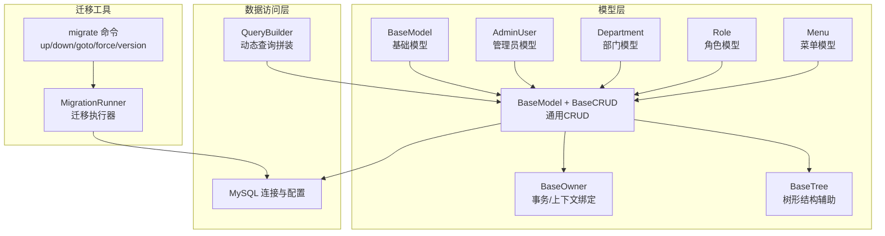
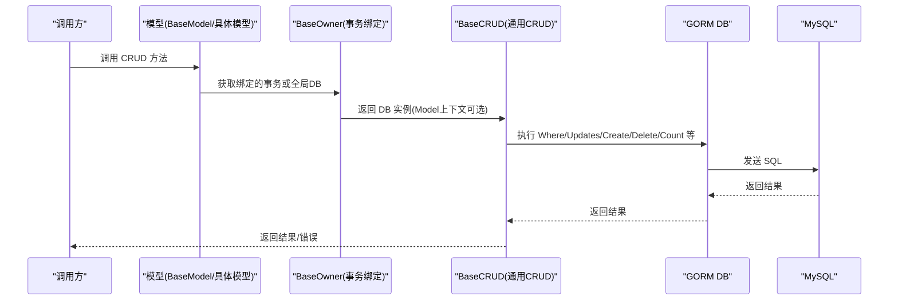
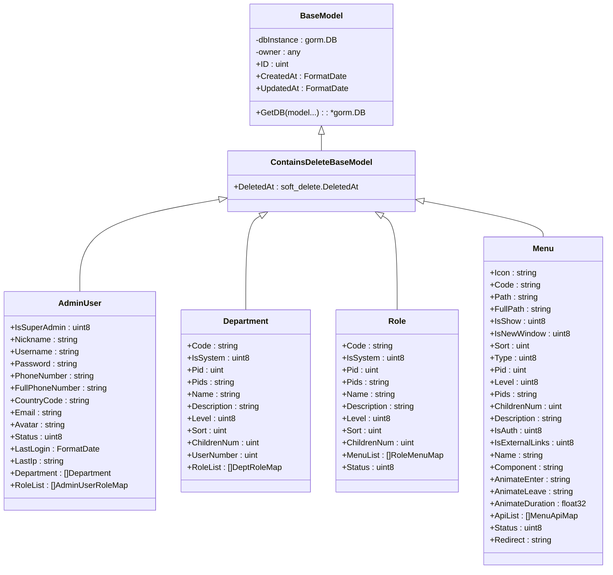
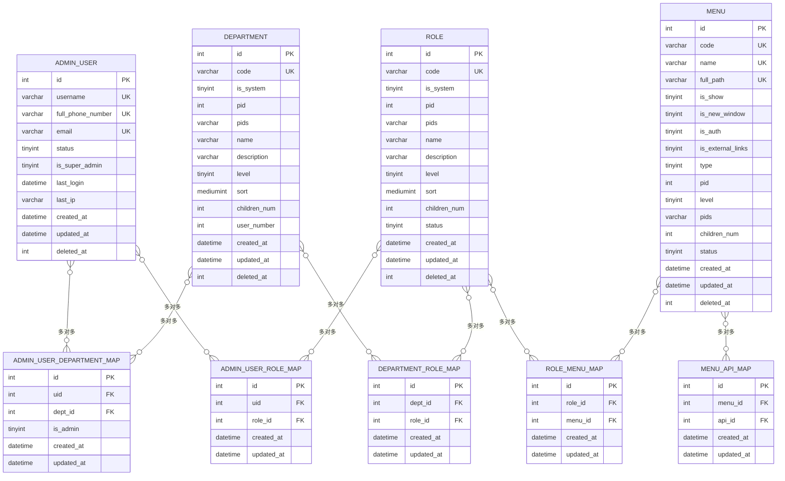
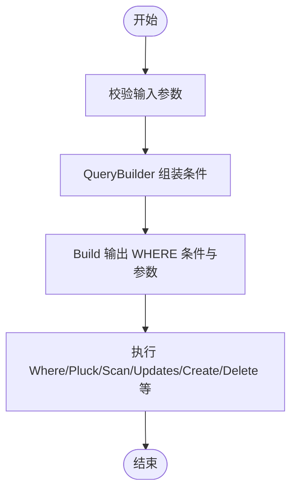
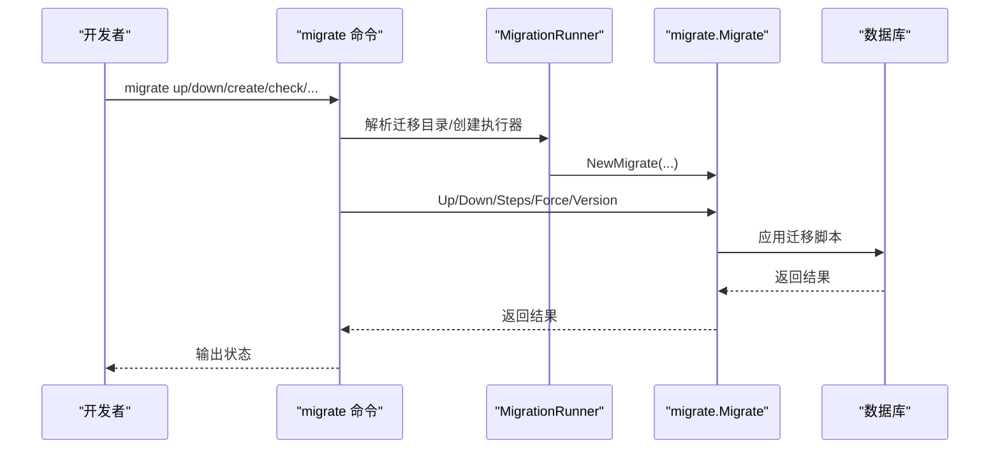
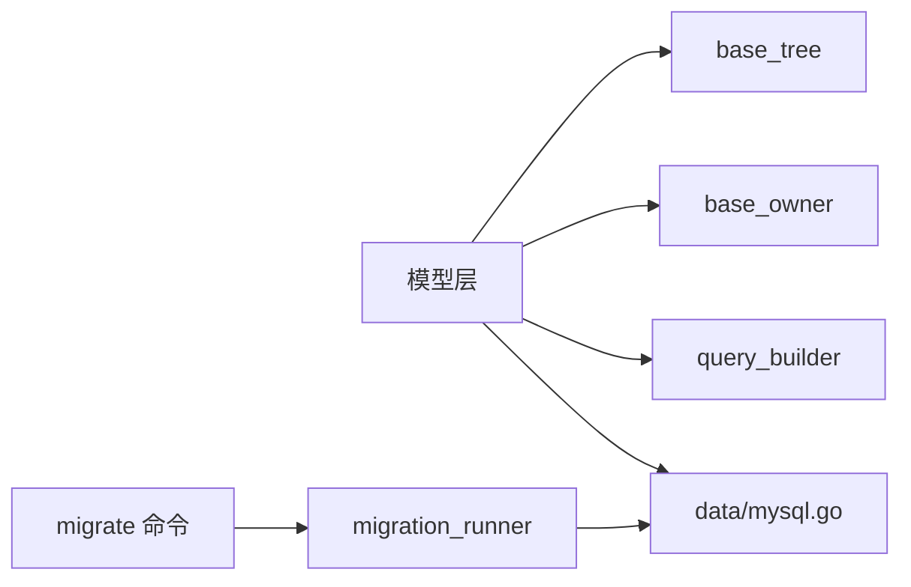

# 数据模型与数据库

<cite>
**本文档引用的文件**
- [internal/model/base.go](file://internal/model/base.go)
- [internal/model/base_crud.go](file://internal/model/base_crud.go)
- [internal/model/base_owner.go](file://internal/model/base_owner.go)
- [internal/model/base_tree.go](file://internal/model/base_tree.go)
- [internal/model/admin_users.go](file://internal/model/admin_users.go)
- [internal/model/dept.go](file://internal/model/dept.go)
- [internal/model/role.go](file://internal/model/role.go)
- [internal/model/menu.go](file://internal/model/menu.go)
- [data/mysql.go](file://data/mysql.go)
- [config/autoload/mysql.go](file://config/autoload/mysql.go)
- [data/migrations/20260425000001_init_table.up.sql](file://data/migrations/20260425000001_init_table.up.sql)
- [data/migrations/20260425000002_init_data.up.sql](file://data/migrations/20260425000002_init_data.up.sql)
- [internal/pkg/query_builder/query_builder.go](file://internal/pkg/query_builder/query_builder.go)
- [internal/console/migrate/migrate.go](file://internal/console/migrate/migrate.go)
- [internal/service/system/migration_runner.go](file://internal/service/system/migration_runner.go)
</cite>

## 目录
1. [简介](#简介)
2. [项目结构](#项目结构)
3. [核心组件](#核心组件)
4. [架构总览](#架构总览)
5. [详细组件分析](#详细组件分析)
6. [依赖分析](#依赖分析)
7. [性能考虑](#性能考虑)
8. [故障排查指南](#故障排查指南)
9. [结论](#结论)
10. [附录](#附录)

## 简介
本文件聚焦于项目的数据模型与数据库设计，围绕以下目标展开：
- GORM 模型定义规范与继承体系
- 关联关系设计与多对多/一对多映射
- 数据库表结构与索引策略
- 基础 CRUD 与查询构建器使用
- 数据库迁移管理、版本控制与一致性保障
- 数据校验、业务规则与约束
- 性能优化、索引与查询技巧
- 数据安全、备份与迁移最佳实践

## 项目结构
本项目采用“模型层 + 数据访问层 + 迁移工具”的分层组织方式：
- 模型层：位于 internal/model，定义 GORM 模型、基础基类与通用 CRUD 能力
- 数据访问层：位于 data，封装 MySQL 连接、连接池与运行时健康检查
- 迁移工具：位于 internal/console/migrate 与 internal/service/system，提供命令行迁移能力与迁移执行器

图表来源
- [internal/model/base.go:15-37](file://internal/model/base.go#L15-L37)
- [internal/model/base_crud.go:12-193](file://internal/model/base_crud.go#L12-L193)
- [internal/model/base_owner.go:9-47](file://internal/model/base_owner.go#L9-L47)
- [internal/model/base_tree.go:5-42](file://internal/model/base_tree.go#L5-L42)
- [internal/model/admin_users.go:30-47](file://internal/model/admin_users.go#L30-L47)
- [internal/model/dept.go:9-23](file://internal/model/dept.go#L9-L23)
- [internal/model/role.go:16-30](file://internal/model/role.go#L16-L30)
- [internal/model/menu.go:9-35](file://internal/model/menu.go#L9-L35)
- [data/mysql.go:104-187](file://data/mysql.go#L104-L187)
- [internal/pkg/query_builder/query_builder.go:5-85](file://internal/pkg/query_builder/query_builder.go#L5-L85)
- [internal/console/migrate/migrate.go:42-142](file://internal/console/migrate/migrate.go#L42-L142)
- [internal/service/system/migration_runner.go:11-39](file://internal/service/system/migration_runner.go#L11-L39)

章节来源
- [internal/model/base.go:15-37](file://internal/model/base.go#L15-L37)
- [internal/model/base_crud.go:12-193](file://internal/model/base_crud.go#L12-L193)
- [internal/model/base_owner.go:9-47](file://internal/model/base_owner.go#L9-L47)
- [internal/model/base_tree.go:5-42](file://internal/model/base_tree.go#L5-L42)
- [internal/model/admin_users.go:30-47](file://internal/model/admin_users.go#L30-L47)
- [internal/model/dept.go:9-23](file://internal/model/dept.go#L9-L23)
- [internal/model/role.go:16-30](file://internal/model/role.go#L16-L30)
- [internal/model/menu.go:9-35](file://internal/model/menu.go#L9-L35)
- [data/mysql.go:104-187](file://data/mysql.go#L104-L187)
- [internal/pkg/query_builder/query_builder.go:5-85](file://internal/pkg/query_builder/query_builder.go#L5-L85)
- [internal/console/migrate/migrate.go:42-142](file://internal/console/migrate/migrate.go#L42-L142)
- [internal/service/system/migration_runner.go:11-39](file://internal/service/system/migration_runner.go#L11-L39)

## 核心组件
- 基础模型与通用 CRUD
  - BaseModel：提供通用字段（自增主键、创建/更新时间）与软删除字段
  - BaseCRUD：提供分页、统计、按条件查询、存在性判断、更新、删除、创建、保存等通用能力
  - BaseOwner：提供事务绑定与模型上下文绑定，确保 CRUD 方法在事务内正确工作
  - BaseTree：提供树形结构的子节点计数与层级更新辅助函数
- 数据库连接与配置
  - data/mysql.go：封装 GORM 初始化、连接池配置、运行时健康探测、日志输出
  - config/autoload/mysql.go：定义 MySQL 配置结构与默认值
- 查询构建器
  - internal/pkg/query_builder/query_builder.go：提供链式条件拼装（等于、IN、LIKE、关键字多字段 LIKE、EXISTS 子查询）
- 迁移管理
  - internal/console/migrate/migrate.go：提供 migrate 命令族（create/check/up/down/goto/force/version）
  - internal/service/system/migration_runner.go：提供迁移执行器工厂与迁移目录解析

章节来源
- [internal/model/base.go:15-37](file://internal/model/base.go#L15-L37)
- [internal/model/base_crud.go:12-193](file://internal/model/base_crud.go#L12-L193)
- [internal/model/base_owner.go:9-47](file://internal/model/base_owner.go#L9-L47)
- [internal/model/base_tree.go:5-42](file://internal/model/base_tree.go#L5-L42)
- [data/mysql.go:104-187](file://data/mysql.go#L104-L187)
- [config/autoload/mysql.go:5-51](file://config/autoload/mysql.go#L5-L51)
- [internal/pkg/query_builder/query_builder.go:5-85](file://internal/pkg/query_builder/query_builder.go#L5-L85)
- [internal/console/migrate/migrate.go:42-142](file://internal/console/migrate/migrate.go#L42-L142)
- [internal/service/system/migration_runner.go:11-39](file://internal/service/system/migration_runner.go#L11-L39)

## 架构总览
下图展示了从模型调用到数据库执行的关键流程，以及迁移工具如何与数据库交互。

图表来源
- [internal/model/base_owner.go:34-46](file://internal/model/base_owner.go#L34-L46)
- [internal/model/base_crud.go:29-193](file://internal/model/base_crud.go#L29-L193)
- [data/mysql.go:190-200](file://data/mysql.go#L190-L200)

章节来源
- [internal/model/base_owner.go:34-46](file://internal/model/base_owner.go#L34-L46)
- [internal/model/base_crud.go:29-193](file://internal/model/base_crud.go#L29-L193)
- [data/mysql.go:190-200](file://data/mysql.go#L190-L200)

## 详细组件分析

### 基础模型与继承关系
- BaseModel
  - 字段：自增主键、创建/更新时间、软删除字段
  - 能力：GetDB 支持传入模型以绑定 Model 上下文；参数校验防止无效指针
- ContainsDeleteBaseModel
  - 在 BaseModel 基础上增加 DeletedAt 字段，并建立索引
- 继承与组合
  - 具体模型（AdminUser/Department/Role/Menu）均嵌入 ContainsDeleteBaseModel，从而获得通用字段与软删除能力
  - 通过 BindModel 将具体模型实例绑定到自身，供通用方法回写使用

图表来源
- [internal/model/base.go:15-37](file://internal/model/base.go#L15-L37)
- [internal/model/admin_users.go:30-47](file://internal/model/admin_users.go#L30-L47)
- [internal/model/dept.go:9-23](file://internal/model/dept.go#L9-L23)
- [internal/model/role.go:16-30](file://internal/model/role.go#L16-L30)
- [internal/model/menu.go:9-35](file://internal/model/menu.go#L9-L35)

章节来源
- [internal/model/base.go:15-37](file://internal/model/base.go#L15-L37)
- [internal/model/admin_users.go:30-47](file://internal/model/admin_users.go#L30-L47)
- [internal/model/dept.go:9-23](file://internal/model/dept.go#L9-L23)
- [internal/model/role.go:16-30](file://internal/model/role.go#L16-L30)
- [internal/model/menu.go:9-35](file://internal/model/menu.go#L9-L35)

### 关联关系设计
- 管理员与部门（多对多）
  - AdminUser.Department 通过中间表 admin_user_department_map 映射
- 管理员与角色（多对多）
  - AdminUser.RoleList 通过 admin_user_role_map 映射
- 角色与菜单（多对多）
  - Role.MenuList 通过 role_menu_map 映射
- 菜单与 API（多对多）
  - Menu.ApiList 通过 menu_api_map 映射
- 部门与角色（多对多）
  - Department.RoleList 通过 department_role_map 映射

图表来源
- [data/migrations/20260425000001_init_table.up.sql:3-798](file://data/migrations/20260425000001_init_table.up.sql#L3-L798)
- [internal/model/admin_users.go:45-46](file://internal/model/admin_users.go#L45-L46)
- [internal/model/dept.go](file://internal/model/dept.go#L22)
- [internal/model/role.go](file://internal/model/role.go#L28)
- [internal/model/menu.go](file://internal/model/menu.go#L32)

章节来源
- [internal/model/admin_users.go:45-46](file://internal/model/admin_users.go#L45-L46)
- [internal/model/dept.go](file://internal/model/dept.go#L22)
- [internal/model/role.go](file://internal/model/role.go#L28)
- [internal/model/menu.go](file://internal/model/menu.go#L32)
- [data/migrations/20260425000001_init_table.up.sql:194-293](file://data/migrations/20260425000001_init_table.up.sql#L194-L293)

### 数据库表结构与索引策略
- 主要表与关键索引
  - admin_user：唯一索引（username, deleted_at）、复合索引（status, deleted_at）、（full_phone_number, deleted_at）、（email, deleted_at）、（created_at, deleted_at）
  - api：唯一索引（code, deleted_at）、复合索引（route, method, deleted_at）、（group_code, deleted_at, sort）、（is_auth, deleted_at）、（updated_at）
  - menu：唯一索引（code, deleted_at）、（name, deleted_at）、（path, deleted_at）、（is_auth, deleted_at）、（status, deleted_at）、（pid, deleted_at, sort, id）、（pids, deleted_at）
  - role：唯一索引（code, deleted_at）、（name, deleted_at）、（is_system, deleted_at）、（pid, deleted_at, sort, id）、（status, deleted_at）、（pids, deleted_at）
  - department：唯一索引（code, deleted_at）、（name, deleted_at）、（is_system, deleted_at）、（pid, deleted_at, sort, id）、（pids, deleted_at）
  - 其他业务表（如登录日志、请求日志、导出记录、字典、任务等）均包含 deleted_at 并建立相应复合索引以支持软删除过滤与范围查询

章节来源
- [data/migrations/20260425000001_init_table.up.sql:3-798](file://data/migrations/20260425000001_init_table.up.sql#L3-L798)

### 基础 CRUD 与查询构建器
- 分页与统计
  - Paginate：基于页码与每页大小生成 Offset/Limit
  - Count：按条件统计记录总数
- 查询与存在性
  - GetById/GetAllById/GetDetail：按主键、关联预加载、条件查询
  - Exists/ExistsById：存在性判断，限制单条以减少开销
- 更新与删除
  - UpdateById：按主键更新字段映射
  - DeleteByID/DeleteWhere：按主键删除；DeleteWhere 空条件拒绝以避免误删
- 创建与保存
  - Create/CreateBatch：字段映射创建与批量创建
  - Save：存在主键则更新
- 查询构建器
  - QueryBuilder：支持 AddEq/AddIn/AddLike/AddKeywordLike/AddExists/AddConditionf，最终 Build 输出 WHERE 条件与参数数组

图表来源
- [internal/pkg/query_builder/query_builder.go:17-85](file://internal/pkg/query_builder/query_builder.go#L17-L85)
- [internal/model/base_crud.go:29-193](file://internal/model/base_crud.go#L29-L193)

章节来源
- [internal/pkg/query_builder/query_builder.go:17-85](file://internal/pkg/query_builder/query_builder.go#L17-L85)
- [internal/model/base_crud.go:29-193](file://internal/model/base_crud.go#L29-L193)

### 数据库迁移管理
- 命令行迁移
  - migrate create：生成 up/down 迁移文件（支持时间戳或顺序版本）
  - migrate check：校验文件命名与版本配对
  - migrate up/down/goto/force/version：执行迁移、回滚、跳转到指定版本、强制设置版本、查看当前版本
- 迁移执行器
  - ResolveMigrationsPath：解析迁移目录
  - NewMigrator/NewMigratorWithPath：创建迁移执行器（自动解析或指定目录）

图表来源
- [internal/console/migrate/migrate.go:174-357](file://internal/console/migrate/migrate.go#L174-L357)
- [internal/service/system/migration_runner.go:11-39](file://internal/service/system/migration_runner.go#L11-L39)

章节来源
- [internal/console/migrate/migrate.go:174-357](file://internal/console/migrate/migrate.go#L174-L357)
- [internal/service/system/migration_runner.go:11-39](file://internal/service/system/migration_runner.go#L11-L39)

### 初始化数据与系统默认值
- 初始化数据迁移
  - 插入超级管理员、默认部门、默认角色、菜单与权限分组、字典与配置等
  - 通过 INSERT/ON DUPLICATE KEY UPDATE 保证幂等性

章节来源
- [data/migrations/20260425000002_init_data.up.sql:5-526](file://data/migrations/20260425000002_init_data.up.sql#L5-L526)

## 依赖分析
- 模型层依赖
  - BaseModel/ContainsDeleteBaseModel 依赖 data 包提供的 GetDB 与 MysqlDB
  - BaseOwner 依赖 gorm.DB 事务上下文
  - BaseTree 依赖 gorm.DB 计数与更新
- 查询构建器
  - QueryBuilder 仅依赖字符串拼接，无外部依赖
- 迁移工具
  - 依赖 golang-migrate/migrate 与 Cobra 命令框架

图表来源
- [internal/model/base.go:39-58](file://internal/model/base.go#L39-L58)
- [data/mysql.go:190-200](file://data/mysql.go#L190-L200)
- [internal/pkg/query_builder/query_builder.go:5-85](file://internal/pkg/query_builder/query_builder.go#L5-L85)
- [internal/console/migrate/migrate.go:174-357](file://internal/console/migrate/migrate.go#L174-L357)
- [internal/service/system/migration_runner.go:11-39](file://internal/service/system/migration_runner.go#L11-L39)

章节来源
- [internal/model/base.go:39-58](file://internal/model/base.go#L39-L58)
- [data/mysql.go:190-200](file://data/mysql.go#L190-L200)
- [internal/pkg/query_builder/query_builder.go:5-85](file://internal/pkg/query_builder/query_builder.go#L5-L85)
- [internal/console/migrate/migrate.go:174-357](file://internal/console/migrate/migrate.go#L174-L357)
- [internal/service/system/migration_runner.go:11-39](file://internal/service/system/migration_runner.go#L11-L39)

## 性能考虑
- 连接池与日志
  - 连接池参数：最大空闲连接、最大打开连接、最大生命周期
  - GORM 日志级别与 SQL 打印开关
- 查询优化
  - 使用软删除字段（deleted_at）配合复合索引进行高效过滤
  - 对高频查询字段建立复合索引（如 status+deleted_at、pid+deleted_at+sort+id）
  - 使用 Pluck/Scan 减少不必要的对象映射开销
  - 使用 Preload/Joins 控制关联加载，避免 N+1 查询
- 分页与统计
  - Paginate 限制 Offset/Limit，避免深分页导致的性能问题
  - Count 仅统计满足条件的记录数，避免全表扫描
- 事务与锁
  - ExistsWithLock 使用行锁避免并发冲突
  - UpdateChildrenNum 在事务中更新父子节点计数，保证一致性

章节来源
- [data/mysql.go:136-187](file://data/mysql.go#L136-L187)
- [config/autoload/mysql.go:23-33](file://config/autoload/mysql.go#L23-L33)
- [internal/model/base_crud.go:12-27](file://internal/model/base_crud.go#L12-L27)
- [internal/model/admin_users.go:119-158](file://internal/model/admin_users.go#L119-L158)
- [internal/model/base_tree.go:14-41](file://internal/model/base_tree.go#L14-L41)

## 故障排查指南
- 数据库连接不可用
  - ErrDBUninitialized：数据库连接未初始化
  - ErrDBUnavailable：数据库连接当前不可用
  - MysqlRuntimeStatus/MysqlReady：运行时健康探测与可用性判断
- 参数校验
  - ErrInvalidModelArg：传入 GetDB 的模型参数无效（如 nil 指针）
  - ErrModelPtrNotImplemented：模型 owner 绑定未完成
- 迁移相关
  - 文件命名不合法：migrate check 报错
  - 版本重复：nextMigrationVersion 校验
  - 强制版本：migrate force 设置版本
  - 回滚/升级：migrate down/up 步骤控制

章节来源
- [internal/model/base.go:24-31](file://internal/model/base.go#L24-L31)
- [data/mysql.go:207-230](file://data/mysql.go#L207-L230)
- [internal/console/migrate/migrate.go:221-264](file://internal/console/migrate/migrate.go#L221-L264)
- [internal/console/migrate/migrate.go:417-449](file://internal/console/migrate/migrate.go#L417-L449)
- [internal/console/migrate/migrate.go:105-122](file://internal/console/migrate/migrate.go#L105-L122)

## 结论
本项目通过清晰的模型继承体系、完善的通用 CRUD 能力、灵活的查询构建器与严格的迁移管理，实现了可维护、可扩展、可演进的数据层设计。结合软删除、复合索引与连接池配置，能够在保证数据一致性的前提下，满足高并发与复杂查询场景的需求。

## 附录
- 数据模型定义规范
  - 字段命名与注释：遵循统一的字段命名与注释风格
  - 软删除：统一使用 deleted_at 字段与复合索引
  - 关联映射：明确多对多/一对多关系与中间表
- 迁移最佳实践
  - 命名规范：时间戳或顺序版本，保持 up/down 成对
  - 幂等性：使用 INSERT/ON DUPLICATE KEY UPDATE
  - 版本控制：严格校验版本配对，避免重复与缺失
- 安全与备份
  - 登录安全：登录失败锁定与锁定时长配置
  - 脱敏配置：敏感字段脱敏策略
  - 备份策略：定期备份与恢复演练（建议结合数据库层面的物理/逻辑备份方案）