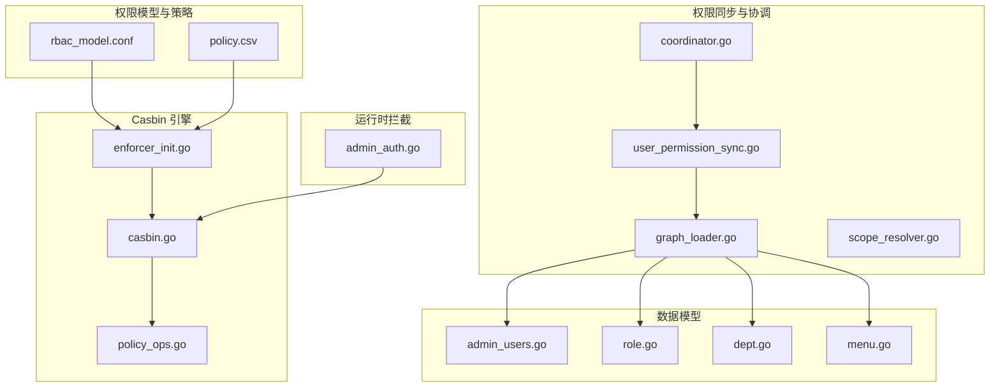
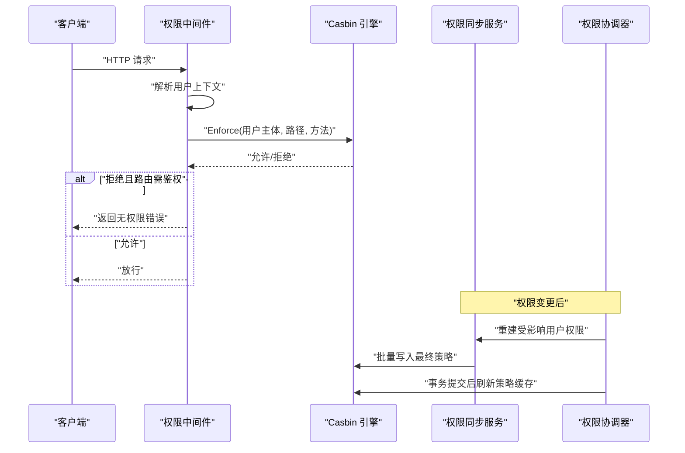
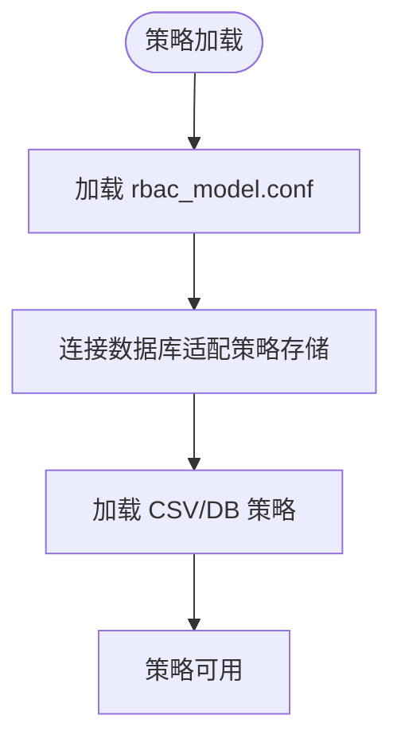
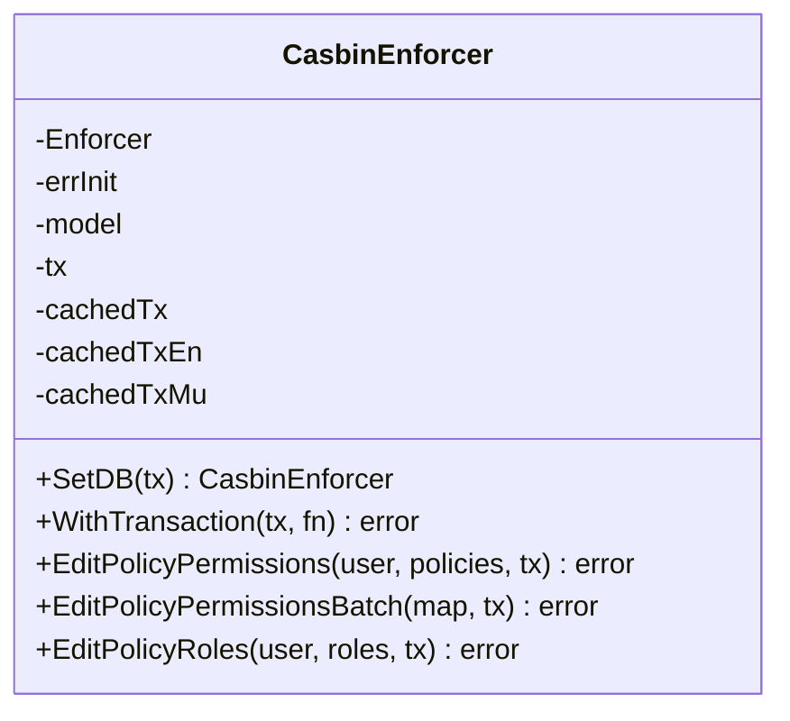
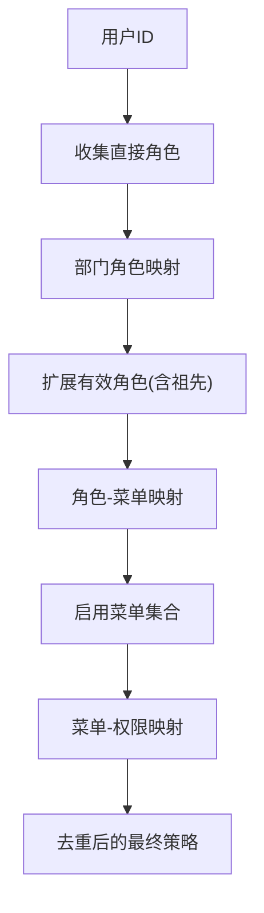
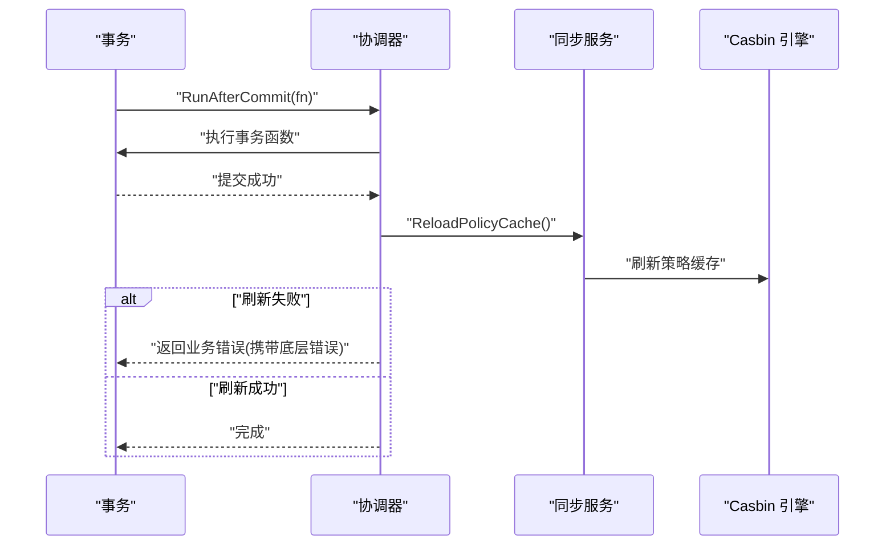
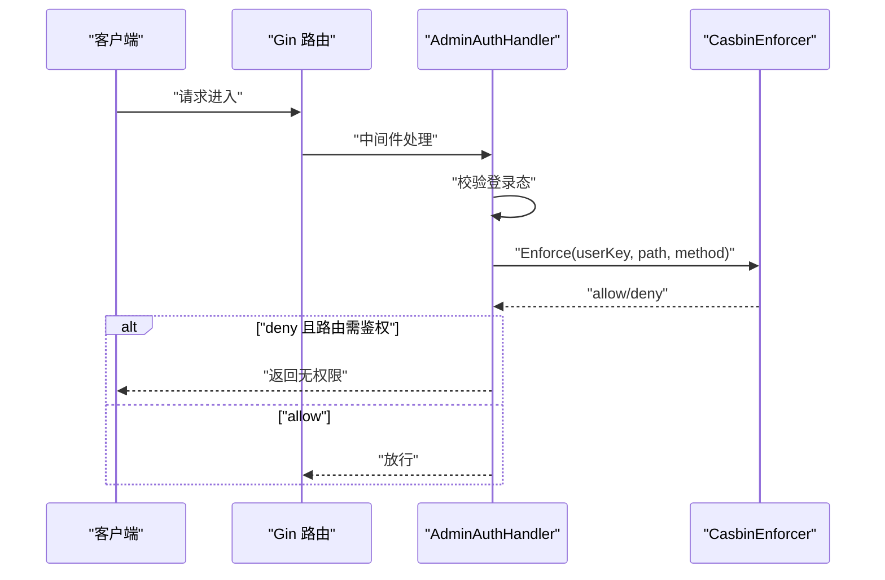
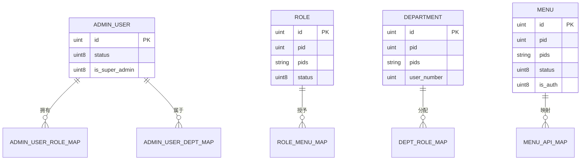
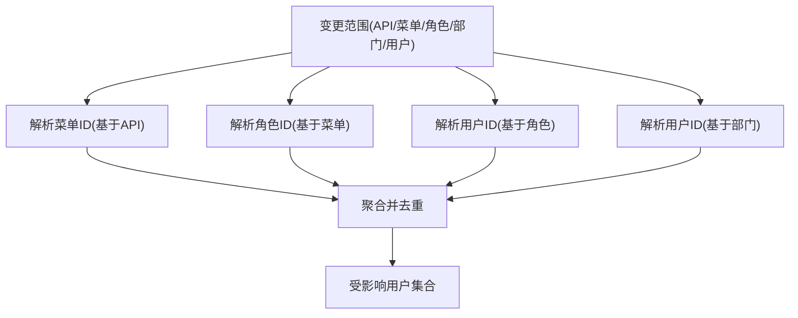
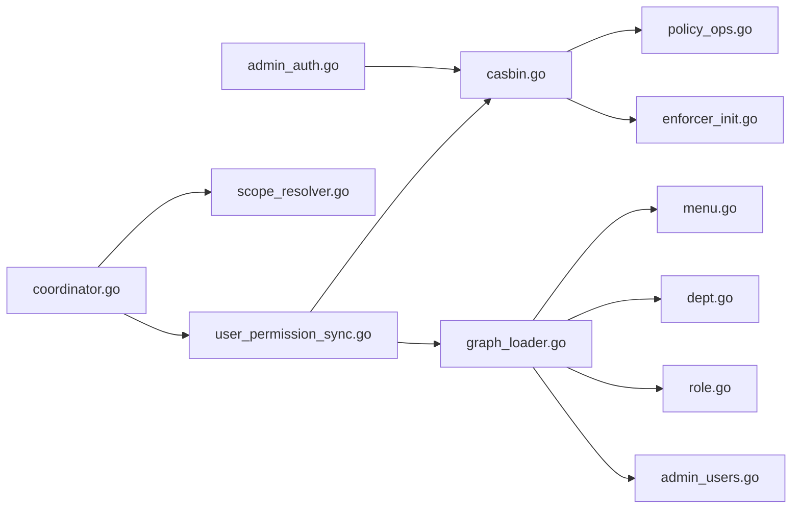

# 权限控制系统

<cite>
**本文引用的文件**
- [rbac_model.conf](file://rbac_model.conf)
- [policy.csv](file://policy.csv)
- [internal/access/casbin/casbin.go](file://internal/access/casbin/casbin.go)
- [internal/access/casbin/enforcer_init.go](file://internal/access/casbin/enforcer_init.go)
- [internal/access/casbin/policy_ops.go](file://internal/access/casbin/policy_ops.go)
- [internal/service/access/coordinator.go](file://internal/service/access/coordinator.go)
- [internal/service/access/user_permission_sync.go](file://internal/service/access/user_permission_sync.go)
- [internal/service/access/graph_loader.go](file://internal/service/access/graph_loader.go)
- [internal/service/access/scope_resolver.go](file://internal/service/access/scope_resolver.go)
- [internal/middleware/admin_auth.go](file://internal/middleware/admin_auth.go)
- [internal/model/admin_users.go](file://internal/model/admin_users.go)
- [internal/model/role.go](file://internal/model/role.go)
- [internal/model/dept.go](file://internal/model/dept.go)
- [internal/model/menu.go](file://internal/model/menu.go)
- [internal/controller/admin_v1/auth_role.go](file://internal/controller/admin_v1/auth_role.go)
</cite>

## 目录
1. [简介](#简介)
2. [项目结构](#项目结构)
3. [核心组件](#核心组件)
4. [架构总览](#架构总览)
5. [组件详解](#组件详解)
6. [依赖关系分析](#依赖关系分析)
7. [性能考量](#性能考量)
8. [故障排查指南](#故障排查指南)
9. [结论](#结论)
10. [附录](#附录)

## 简介
本文件面向权限控制系统，系统基于 RBAC（基于角色的访问控制）模型，结合 Casbin 权限引擎实现策略管理与运行时授权。项目实现了从用户、角色、部门到菜单与 API 的完整权限关系链路，并提供权限同步、缓存刷新、受影响用户解析与事务内一致性保障等能力。同时，文档对权限验证流程、策略配置、审计追踪与性能优化策略进行深入说明，帮助读者快速理解并高效维护权限体系。

## 项目结构
权限相关模块主要分布在以下位置：
- 权限模型与策略：rbac_model.conf、policy.csv
- Casbin 引擎封装：internal/access/casbin/*
- 权限同步与协调：internal/service/access/*
- 中间件与控制器：internal/middleware/admin_auth.go、internal/controller/admin_v1/auth_role.go
- 数据模型：internal/model/*（用户、角色、部门、菜单）

**图示来源**
- [rbac_model.conf:1-14](file://rbac_model.conf#L1-L14)
- [policy.csv:1-30](file://policy.csv#L1-L30)
- [internal/access/casbin/casbin.go:1-81](file://internal/access/casbin/casbin.go#L1-L81)
- [internal/access/casbin/enforcer_init.go:1-69](file://internal/access/casbin/enforcer_init.go#L1-L69)
- [internal/access/casbin/policy_ops.go:1-133](file://internal/access/casbin/policy_ops.go#L1-L133)
- [internal/service/access/coordinator.go:1-175](file://internal/service/access/coordinator.go#L1-L175)
- [internal/service/access/user_permission_sync.go:1-196](file://internal/service/access/user_permission_sync.go#L1-L196)
- [internal/service/access/graph_loader.go:1-515](file://internal/service/access/graph_loader.go#L1-L515)
- [internal/service/access/scope_resolver.go:1-137](file://internal/service/access/scope_resolver.go#L1-L137)
- [internal/middleware/admin_auth.go:1-126](file://internal/middleware/admin_auth.go#L1-L126)
- [internal/model/admin_users.go:1-171](file://internal/model/admin_users.go#L1-L171)
- [internal/model/role.go:1-165](file://internal/model/role.go#L1-L165)
- [internal/model/dept.go:1-74](file://internal/model/dept.go#L1-L74)
- [internal/model/menu.go:1-212](file://internal/model/menu.go#L1-L212)

**章节来源**
- [rbac_model.conf:1-14](file://rbac_model.conf#L1-L14)
- [policy.csv:1-30](file://policy.csv#L1-L30)
- [internal/access/casbin/casbin.go:1-81](file://internal/access/casbin/casbin.go#L1-L81)
- [internal/access/casbin/enforcer_init.go:1-69](file://internal/access/casbin/enforcer_init.go#L1-L69)
- [internal/access/casbin/policy_ops.go:1-133](file://internal/access/casbin/policy_ops.go#L1-L133)
- [internal/service/access/coordinator.go:1-175](file://internal/service/access/coordinator.go#L1-L175)
- [internal/service/access/user_permission_sync.go:1-196](file://internal/service/access/user_permission_sync.go#L1-L196)
- [internal/service/access/graph_loader.go:1-515](file://internal/service/access/graph_loader.go#L1-L515)
- [internal/service/access/scope_resolver.go:1-137](file://internal/service/access/scope_resolver.go#L1-L137)
- [internal/middleware/admin_auth.go:1-126](file://internal/middleware/admin_auth.go#L1-L126)
- [internal/model/admin_users.go:1-171](file://internal/model/admin_users.go#L1-L171)
- [internal/model/role.go:1-165](file://internal/model/role.go#L1-L165)
- [internal/model/dept.go:1-74](file://internal/model/dept.go#L1-L74)
- [internal/model/menu.go:1-212](file://internal/model/menu.go#L1-L212)

## 核心组件
- Casbin 权限引擎封装：负责模型加载、策略持久化适配、事务态 Enforcer 管理与批量策略编辑。
- 权限同步服务：将用户-角色-部门-菜单-API 的关系链路展开为最终 API 权限策略并写入 Casbin。
- 权限协调器：统一触发权限重建、受影响用户解析、事务后策略缓存刷新与重试机制。
- 权限中间件：在请求阶段以用户主体与请求路径/方法进行实时授权判断。
- 数据模型：提供用户、角色、部门、菜单及映射关系的查询与树形结构支持。

**章节来源**
- [internal/access/casbin/casbin.go:13-81](file://internal/access/casbin/casbin.go#L13-L81)
- [internal/service/access/user_permission_sync.go:10-36](file://internal/service/access/user_permission_sync.go#L10-L36)
- [internal/service/access/coordinator.go:14-48](file://internal/service/access/coordinator.go#L14-L48)
- [internal/middleware/admin_auth.go:36-82](file://internal/middleware/admin_auth.go#L36-L82)
- [internal/model/admin_users.go:30-47](file://internal/model/admin_users.go#L30-L47)
- [internal/model/role.go:16-30](file://internal/model/role.go#L16-L30)
- [internal/model/dept.go:9-23](file://internal/model/dept.go#L9-L23)
- [internal/model/menu.go:9-35](file://internal/model/menu.go#L9-L35)

## 架构总览
权限系统由“策略定义—引擎初始化—权限展开—策略写入—运行时拦截—缓存刷新—事务一致性”构成闭环。

**图示来源**
- [internal/middleware/admin_auth.go:89-125](file://internal/middleware/admin_auth.go#L89-L125)
- [internal/service/access/user_permission_sync.go:43-86](file://internal/service/access/user_permission_sync.go#L43-L86)
- [internal/service/access/coordinator.go:115-175](file://internal/service/access/coordinator.go#L115-L175)

## 组件详解

### RBAC 权限模型与策略
- 模型定义：rbac_model.conf 提供请求定义、策略定义、角色定义、策略效果与匹配器。匹配器使用路径通配与正则组合，满足菜单到 API 的细粒度控制。
- 策略样例：policy.csv 展示了用户-角色、角色继承、部门-角色、角色-菜单、菜单-权限的绑定关系，以及验证用例。

**图示来源**
- [rbac_model.conf:1-14](file://rbac_model.conf#L1-L14)
- [policy.csv:1-30](file://policy.csv#L1-L30)

**章节来源**
- [rbac_model.conf:1-14](file://rbac_model.conf#L1-L14)
- [policy.csv:1-30](file://policy.csv#L1-L30)

### Casbin 引擎初始化与事务态 Enforcer
- 初始化：enforcer_init.go 读取模型文件、加载模型、连接数据库并创建 Enforcer 实例，支持重新加载。
- 事务态封装：casbin.go 提供 SetDB 与 execute，按事务缓存 Enforcer，避免重复全量加载；支持批量策略写入与角色组策略编辑。
- 策略操作：policy_ops.go 提供 EditPolicyPermissions、EditPolicyPermissionsBatch、EditPolicyRoles 等操作。

**图示来源**
- [internal/access/casbin/casbin.go:14-81](file://internal/access/casbin/casbin.go#L14-L81)
- [internal/access/casbin/policy_ops.go:43-94](file://internal/access/casbin/policy_ops.go#L43-L94)

**章节来源**
- [internal/access/casbin/enforcer_init.go:37-68](file://internal/access/casbin/enforcer_init.go#L37-L68)
- [internal/access/casbin/casbin.go:14-81](file://internal/access/casbin/casbin.go#L14-L81)
- [internal/access/casbin/policy_ops.go:43-133](file://internal/access/casbin/policy_ops.go#L43-L133)

### 权限同步与最终策略生成
- 单用户链路：collectUserPolicies → userRoleIDs → RoleMenuIDs → menuAPIPolicies，生成用户最终 API 权限。
- 批量链路：collectPoliciesForUsers → userBaseRoleMap → expandUserRoles → roleMenuMap → collectMenuPermissionData → buildUserPolicies，去重合并策略。
- 工具函数：buildAncestorSet、addAncestorIDs、expandRoleAncestors、dedupePolicies 等支撑树形关系与策略去重。

**图示来源**
- [internal/service/access/graph_loader.go:16-37](file://internal/service/access/graph_loader.go#L16-L37)
- [internal/service/access/graph_loader.go:116-143](file://internal/service/access/graph_loader.go#L116-L143)
- [internal/service/access/graph_loader.go:169-188](file://internal/service/access/graph_loader.go#L169-L188)
- [internal/service/access/graph_loader.go:214-237](file://internal/service/access/graph_loader.go#L214-L237)
- [internal/service/access/graph_loader.go:447-492](file://internal/service/access/graph_loader.go#L447-L492)

**章节来源**
- [internal/service/access/user_permission_sync.go:43-86](file://internal/service/access/user_permission_sync.go#L43-L86)
- [internal/service/access/graph_loader.go:16-37](file://internal/service/access/graph_loader.go#L16-L37)
- [internal/service/access/graph_loader.go:116-188](file://internal/service/access/graph_loader.go#L116-L188)
- [internal/service/access/graph_loader.go:214-237](file://internal/service/access/graph_loader.go#L214-L237)
- [internal/service/access/graph_loader.go:447-492](file://internal/service/access/graph_loader.go#L447-L492)

### 权限协调器与事务后缓存刷新
- 协调器职责：统一触发 SyncAll/SyncUser/SyncUsersAffectedByScope/ClearUser；提供 AccessibleMenuIDs；在事务提交后刷新共享策略缓存。
- 重试机制：ReloadPolicyCacheWithCode 采用指数退避+抖动重试，失败后包装业务错误返回，确保“写已提交但缓存未刷新”的问题可被上层感知。

**图示来源**
- [internal/service/access/coordinator.go:158-175](file://internal/service/access/coordinator.go#L158-L175)
- [internal/service/access/user_permission_sync.go:38-41](file://internal/service/access/user_permission_sync.go#L38-L41)

**章节来源**
- [internal/service/access/coordinator.go:50-175](file://internal/service/access/coordinator.go#L50-L175)
- [internal/service/access/user_permission_sync.go:38-41](file://internal/service/access/user_permission_sync.go#L38-L41)

### 权限中间件与运行时授权
- 中间件在 Gin 流程中读取用户上下文，构造用户主体，调用 Enforce 进行授权判断；对未登录、会话过期、权限不足等情况返回相应错误。
- 超级管理员绕过校验，普通用户走策略匹配。

**图示来源**
- [internal/middleware/admin_auth.go:36-82](file://internal/middleware/admin_auth.go#L36-L82)
- [internal/middleware/admin_auth.go:89-125](file://internal/middleware/admin_auth.go#L89-L125)

**章节来源**
- [internal/middleware/admin_auth.go:36-125](file://internal/middleware/admin_auth.go#L36-L125)

### 权限关系与数据模型
- 用户：AdminUser 表含状态、是否超管等字段，权限同步时过滤禁用与超管用户。
- 角色：Role 表含父子关系、层级、状态，支持树形展开与祖先继承。
- 部门：Department 表含父子关系、层级、用户数量，支持部门-角色映射。
- 菜单：Menu 表含类型、状态、鉴权标记、API 映射等，支持启用过滤与父子关系展开。

**图示来源**
- [internal/model/admin_users.go:30-47](file://internal/model/admin_users.go#L30-L47)
- [internal/model/role.go:16-30](file://internal/model/role.go#L16-L30)
- [internal/model/dept.go:9-23](file://internal/model/dept.go#L9-L23)
- [internal/model/menu.go:9-35](file://internal/model/menu.go#L9-L35)

**章节来源**
- [internal/model/admin_users.go:30-47](file://internal/model/admin_users.go#L30-L47)
- [internal/model/role.go:16-30](file://internal/model/role.go#L16-L30)
- [internal/model/dept.go:9-23](file://internal/model/dept.go#L9-L23)
- [internal/model/menu.go:9-35](file://internal/model/menu.go#L9-L35)

### 权限变更影响解析与角色管理
- 影响解析：scope_resolver.Resolve 将 API/菜单/角色/部门变更映射为受影响用户集合，支持角色子树展开与多源聚合。
- 角色管理：控制器提供角色的增删改查接口，配合服务层的审计差异记录，确保权限变更可追溯。

**图示来源**
- [internal/service/access/scope_resolver.go:26-78](file://internal/service/access/scope_resolver.go#L26-L78)

**章节来源**
- [internal/service/access/scope_resolver.go:26-137](file://internal/service/access/scope_resolver.go#L26-L137)
- [internal/controller/admin_v1/auth_role.go:34-97](file://internal/controller/admin_v1/auth_role.go#L34-L97)

## 依赖关系分析
- 中间件依赖 Casbin 引擎进行实时授权。
- 权限同步服务依赖数据模型进行关系展开与策略生成。
- 协调器聚合同步服务与影响解析器，统一事务后缓存刷新。
- 控制器与服务层通过审计差异记录权限变更，驱动协调器进行权限重建。

**图示来源**
- [internal/middleware/admin_auth.go:36-82](file://internal/middleware/admin_auth.go#L36-L82)
- [internal/access/casbin/casbin.go:14-81](file://internal/access/casbin/casbin.go#L14-L81)
- [internal/access/casbin/enforcer_init.go:37-68](file://internal/access/casbin/enforcer_init.go#L37-L68)
- [internal/access/casbin/policy_ops.go:43-94](file://internal/access/casbin/policy_ops.go#L43-L94)
- [internal/service/access/user_permission_sync.go:43-86](file://internal/service/access/user_permission_sync.go#L43-L86)
- [internal/service/access/graph_loader.go:16-37](file://internal/service/access/graph_loader.go#L16-L37)
- [internal/service/access/coordinator.go:50-175](file://internal/service/access/coordinator.go#L50-L175)
- [internal/service/access/scope_resolver.go:26-78](file://internal/service/access/scope_resolver.go#L26-L78)
- [internal/model/admin_users.go:30-47](file://internal/model/admin_users.go#L30-L47)
- [internal/model/role.go:16-30](file://internal/model/role.go#L16-L30)
- [internal/model/dept.go:9-23](file://internal/model/dept.go#L9-L23)
- [internal/model/menu.go:9-35](file://internal/model/menu.go#L9-L35)

**章节来源**
- [internal/middleware/admin_auth.go:36-125](file://internal/middleware/admin_auth.go#L36-L125)
- [internal/service/access/coordinator.go:50-175](file://internal/service/access/coordinator.go#L50-L175)
- [internal/service/access/user_permission_sync.go:43-196](file://internal/service/access/user_permission_sync.go#L43-L196)
- [internal/service/access/graph_loader.go:16-515](file://internal/service/access/graph_loader.go#L16-L515)
- [internal/service/access/scope_resolver.go:26-137](file://internal/service/access/scope_resolver.go#L26-L137)
- [internal/model/admin_users.go:30-171](file://internal/model/admin_users.go#L30-L171)
- [internal/model/role.go:16-165](file://internal/model/role.go#L16-L165)
- [internal/model/dept.go:9-74](file://internal/model/dept.go#L9-L74)
- [internal/model/menu.go:9-212](file://internal/model/menu.go#L9-L212)

## 性能考量
- 事务态 Enforcer 复用：casbin.go 的 execute 与 SetDB 在同一事务内复用 Enforcer，避免全量加载策略带来的开销。
- 批量策略写入：policy_ops.go 的 EditPolicyPermissionsBatch 一次性写入多个用户的策略，降低多次往返成本。
- 策略去重与合并：graph_loader.go 的 dedupePolicies 与 UniqueUintSlice 去重，减少冗余策略条目。
- 缓存刷新重试：coordinator.go 的指数退避+抖动重试，提升缓存刷新稳定性，避免偶发抖动导致的失败风暴。
- 查询去重与树遍历：role、menu 的树形查询与祖先集合构建，配合 EnabledIdsByIds 与映射聚合，减少无效数据传输。

[本节为通用性能建议，不直接分析具体文件]

## 故障排查指南
- 初始化失败：确认 rbac_model.conf 路径正确且存在；检查数据库连接与策略适配器初始化。
- 权限验证失败：核对用户主体格式（UserKey）与请求路径/方法；查看中间件日志与业务错误键。
- 策略未生效：确认事务提交后是否调用 ReloadPolicyCacheWithCode 并观察重试日志；检查 Enforcer 状态。
- 权限不同步：检查受影响用户解析范围（API/菜单/角色/部门）是否正确；确认批量同步是否覆盖目标用户。
- 审计与回溯：利用审计差异记录定位变更点，结合受影响用户解析快速定位受影响用户集合。

**章节来源**
- [internal/middleware/admin_auth.go:98-125](file://internal/middleware/admin_auth.go#L98-L125)
- [internal/service/access/coordinator.go:126-175](file://internal/service/access/coordinator.go#L126-L175)
- [internal/service/access/scope_resolver.go:26-78](file://internal/service/access/scope_resolver.go#L26-L78)

## 结论
本权限系统以 RBAC 为核心，结合 Casbin 的灵活策略模型与项目内的权限同步、协调与中间件拦截，形成从“策略定义—关系展开—策略写入—运行时授权—缓存刷新—事务一致性”的完整闭环。通过事务态 Enforcer 复用、批量策略写入、树形关系与策略去重等手段，系统在功能完整性与性能稳定性之间取得平衡。配合受影响用户解析与审计差异，权限变更具备高可控性与可追溯性。

[本节为总结性内容，不直接分析具体文件]

## 附录
- 关键流程参考路径
  - 权限验证：[internal/middleware/admin_auth.go:89-125](file://internal/middleware/admin_auth.go#L89-L125)
  - 策略写入：[internal/access/casbin/policy_ops.go:43-94](file://internal/access/casbin/policy_ops.go#L43-L94)
  - 权限重建：[internal/service/access/user_permission_sync.go:43-86](file://internal/service/access/user_permission_sync.go#L43-L86)
  - 影响解析：[internal/service/access/scope_resolver.go:26-78](file://internal/service/access/scope_resolver.go#L26-L78)
  - 缓存刷新：[internal/service/access/coordinator.go:126-175](file://internal/service/access/coordinator.go#L126-L175)

[本节为补充索引，不直接分析具体文件]