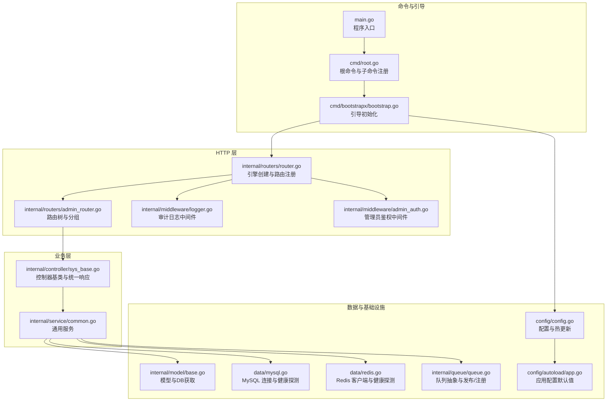
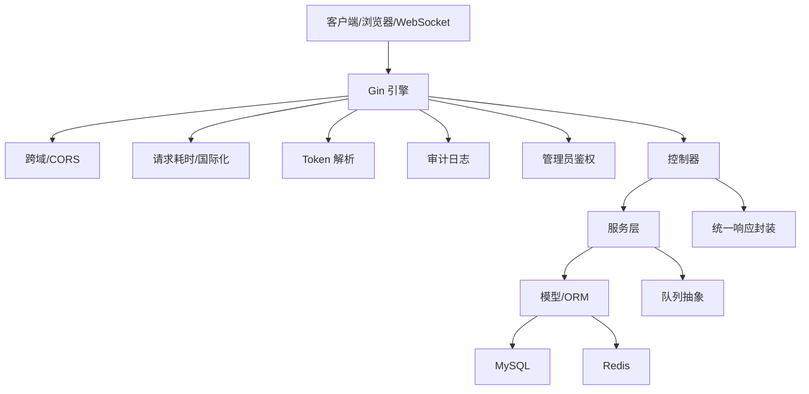
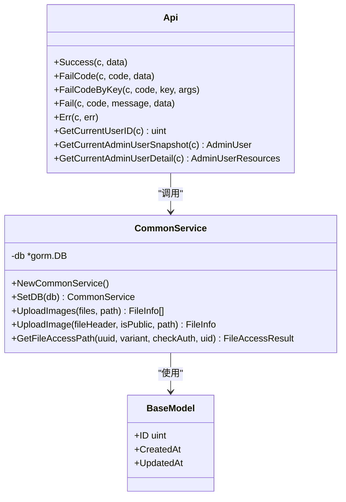
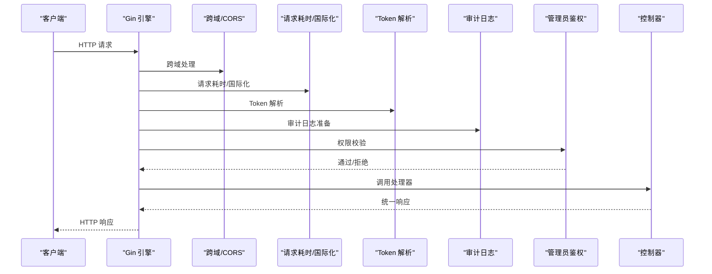
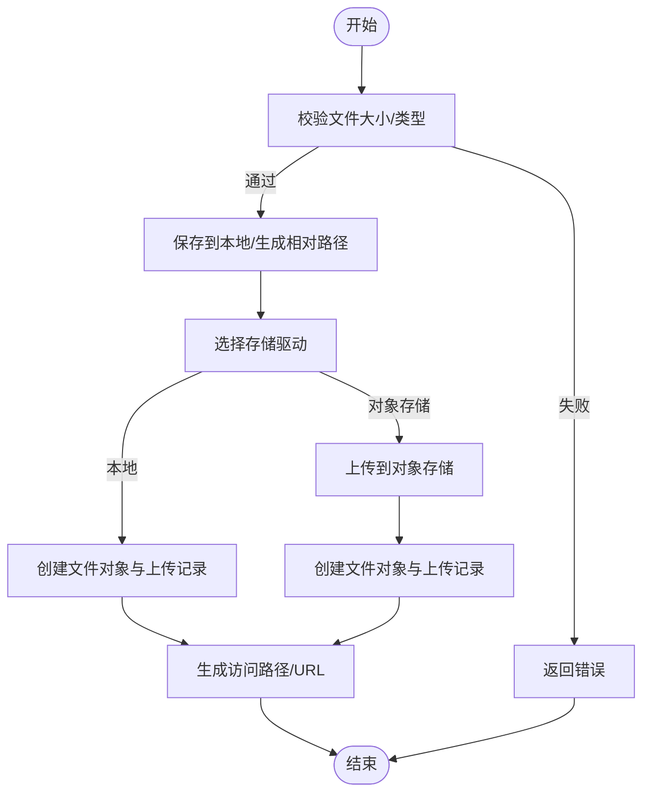
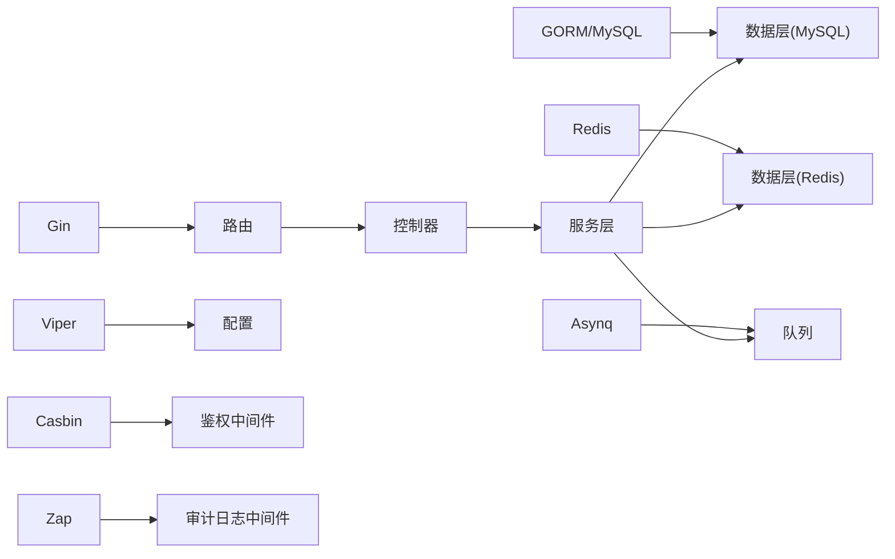

# 架构设计

<cite>
**本文档引用的文件**
- [main.go](file://main.go)
- [root.go](file://cmd/root.go)
- [bootstrap.go](file://cmd/bootstrapx/bootstrap.go)
- [router.go](file://internal/routers/router.go)
- [admin_router.go](file://internal/routers/admin_router.go)
- [logger.go](file://internal/middleware/logger.go)
- [admin_auth.go](file://internal/middleware/admin_auth.go)
- [sys_base.go](file://internal/controller/sys_base.go)
- [common.go](file://internal/service/common.go)
- [base.go](file://internal/model/base.go)
- [config.go](file://config/config.go)
- [app.go](file://config/autoload/app.go)
- [queue.go](file://internal/queue/queue.go)
- [mysql.go](file://data/mysql.go)
- [redis.go](file://data/redis.go)
- [go.mod](file://go.mod)
</cite>

## 目录
1. [引言](#引言)
2. [项目结构](#项目结构)
3. [核心组件](#核心组件)
4. [架构总览](#架构总览)
5. [详细组件分析](#详细组件分析)
6. [依赖分析](#依赖分析)
7. [性能考量](#性能考量)
8. [故障排查指南](#故障排查指南)
9. [结论](#结论)
10. [附录](#附录)

## 引言
本架构设计文档面向 gin-layout 项目，系统性阐述其高层架构模式、分层设计原则、系统边界与组件交互。项目采用 MVC 架构与中间件体系，结合配置驱动、依赖注入与路由树组织，形成清晰的职责分离与可扩展能力。文档同时覆盖基础设施需求、可扩展性与部署拓扑、安全与监控、灾难恢复等横切关注点，并给出技术栈、第三方依赖与版本兼容性说明。

## 项目结构
项目采用“命令入口 -> 引导初始化 -> 路由注册 -> 中间件链 -> 控制器 -> 服务层 -> 数据访问层”的分层组织方式。核心入口位于命令行模块，引导阶段完成配置、时区、日志初始化；路由层通过路由树声明式组织 API；中间件层提供鉴权、审计、跨域、恢复等横切能力；控制器负责请求处理与响应封装；服务层承载业务逻辑；数据层封装数据库与缓存客户端；配置层提供运行时配置与热更新机制。

**图表来源**
- [main.go:1-10](file://main.go#L1-L10)
- [root.go:1-101](file://cmd/root.go#L1-L101)
- [bootstrap.go](file://cmd/bootstrapx/bootstrap.go)
- [router.go:1-268](file://internal/routers/router.go#L1-L268)
- [admin_router.go:1-363](file://internal/routers/admin_router.go#L1-L363)
- [logger.go:1-82](file://internal/middleware/logger.go#L1-L82)
- [admin_auth.go:1-126](file://internal/middleware/admin_auth.go#L1-L126)
- [sys_base.go:1-114](file://internal/controller/sys_base.go#L1-L114)
- [common.go:1-298](file://internal/service/common.go#L1-L298)
- [base.go:1-73](file://internal/model/base.go#L1-L73)
- [mysql.go:1-285](file://data/mysql.go#L1-L285)
- [redis.go:1-172](file://data/redis.go#L1-L172)
- [config.go:1-120](file://config/config.go#L1-L120)
- [app.go:1-81](file://config/autoload/app.go#L1-L81)
- [queue.go:1-413](file://internal/queue/queue.go#L1-L413)

**章节来源**
- [main.go:1-10](file://main.go#L1-L10)
- [root.go:1-101](file://cmd/root.go#L1-L101)
- [router.go:1-268](file://internal/routers/router.go#L1-L268)
- [admin_router.go:1-363](file://internal/routers/admin_router.go#L1-L363)

## 核心组件
- 命令与引导
  - 根命令与子命令注册：版本、补全、服务、命令、计划任务、Worker。
  - 引导初始化：配置加载、时区设置、日志初始化。
- 路由与中间件
  - 路由引擎创建：开发/生产模式差异、信任代理、404统一处理。
  - 中间件：跨域、请求耗时、国际化、Token 解析、恢复、审计日志。
  - 管理员鉴权：基于 Casbin 的 RBAC 权限校验。
- 控制器与服务
  - 控制器基类：统一成功/失败响应、错误处理、用户上下文获取。
  - 通用服务：文件上传、访问路径生成、数据库事务与模型封装。
- 数据与基础设施
  - 模型：通用字段、软删除、DB 获取与错误语义。
  - MySQL：DSN 生成、连接池、慢日志转发、健康探测。
  - Redis：客户端、连接参数、健康探测。
  - 配置：运行时配置快照、热更新回调、变更摘要。
  - 队列：任务发布/注册、选项、Inspector、工厂注册。

**章节来源**
- [root.go:1-101](file://cmd/root.go#L1-L101)
- [bootstrap.go](file://cmd/bootstrapx/bootstrap.go)
- [router.go:1-268](file://internal/routers/router.go#L1-L268)
- [logger.go:1-82](file://internal/middleware/logger.go#L1-L82)
- [admin_auth.go:1-126](file://internal/middleware/admin_auth.go#L1-L126)
- [sys_base.go:1-114](file://internal/controller/sys_base.go#L1-L114)
- [common.go:1-298](file://internal/service/common.go#L1-L298)
- [base.go:1-73](file://internal/model/base.go#L1-L73)
- [mysql.go:1-285](file://data/mysql.go#L1-L285)
- [redis.go:1-172](file://data/redis.go#L1-L172)
- [config.go:1-120](file://config/config.go#L1-L120)
- [queue.go:1-413](file://internal/queue/queue.go#L1-L413)

## 架构总览
gin-layout 采用 MVC 与中间件组合的架构模式：
- 视图层：HTTP 响应封装由控制器基类统一处理。
- 控制器层：接收请求、调用服务、返回响应。
- 服务层：封装业务规则、数据访问与第三方集成。
- 模型层：ORM 抽象与数据库连接管理。
- 基础设施层：配置、日志、数据库、缓存、队列。

系统边界：
- 外部系统：客户端浏览器、WebSocket 客户端、对象存储（可选）。
- 内部系统：管理后台 API、计划任务、异步 Worker。

**图表来源**
- [router.go:45-97](file://internal/routers/router.go#L45-L97)
- [logger.go:27-82](file://internal/middleware/logger.go#L27-L82)
- [admin_auth.go:36-82](file://internal/middleware/admin_auth.go#L36-L82)
- [sys_base.go:20-114](file://internal/controller/sys_base.go#L20-L114)
- [common.go:21-298](file://internal/service/common.go#L21-L298)
- [base.go:39-73](file://internal/model/base.go#L39-L73)
- [mysql.go:189-230](file://data/mysql.go#L189-L230)
- [redis.go:92-133](file://data/redis.go#L92-L133)
- [queue.go:133-162](file://internal/queue/queue.go#L133-L162)

## 详细组件分析

### MVC 架构与依赖注入
- 控制器基类
  - 统一响应封装：成功/失败、错误码与文案键。
  - 错误处理：区分业务错误与服务器错误，结合上下文请求 ID 记录日志。
  - 用户上下文：获取当前用户 ID 与快照。
- 服务层
  - 通用服务：文件上传、访问路径生成、数据库事务与模型封装。
  - 依赖注入：通过构造函数注入 DB 实例，便于测试与事务控制。
- 模型层
  - 通用字段与软删除；DB 获取时附带 Model 上下文，确保表前缀与命名策略一致。
- 依赖注入设计
  - 控制器依赖容器：路由树中通过 ControllerDeps 注入各控制器实例，便于替换与测试。
  - 中间件依赖注入：管理员鉴权中间件支持注入权限校验与路由缓存依赖，便于单元测试。

**图表来源**
- [sys_base.go:20-114](file://internal/controller/sys_base.go#L20-L114)
- [common.go:21-298](file://internal/service/common.go#L21-L298)
- [base.go:15-37](file://internal/model/base.go#L15-L37)

**章节来源**
- [sys_base.go:20-114](file://internal/controller/sys_base.go#L20-L114)
- [common.go:21-298](file://internal/service/common.go#L21-L298)
- [base.go:15-73](file://internal/model/base.go#L15-L73)

### 中间件体系与路由组织
- 中间件
  - 跨域与信任代理：根据配置设置受信代理，保障真实 IP 与协议判断。
  - 请求耗时与国际化：统一统计耗时与语言环境。
  - Token 解析：全局解析 JWT 并写入上下文。
  - 审计日志：请求体快照、响应体快照、WebSocket 识别、跳过高频路径。
  - 管理员鉴权：非超级管理员进行权限校验，支持注入依赖。
- 路由组织
  - 路由树：声明式定义路由与分组，支持中间件链与权限模式。
  - 就绪检查：健康检查接口聚合 MySQL、Redis、队列状态。

**图表来源**
- [router.go:45-97](file://internal/routers/router.go#L45-L97)
- [logger.go:27-82](file://internal/middleware/logger.go#L27-L82)
- [admin_auth.go:36-82](file://internal/middleware/admin_auth.go#L36-L82)

**章节来源**
- [router.go:19-131](file://internal/routers/router.go#L19-L131)
- [admin_router.go:20-79](file://internal/routers/admin_router.go#L20-L79)
- [logger.go:17-82](file://internal/middleware/logger.go#L17-L82)
- [admin_auth.go:18-126](file://internal/middleware/admin_auth.go#L18-L126)

### 数据流与集成模式
- 文件上传流程
  - 校验与归一化：文件大小、类型、上传目录。
  - 存储驱动选择：本地或对象存储（如 OSS），生成访问路径或签名 URL。
  - 数据库记录：文件对象与上传记录创建，支持复用与清理。
- 数据库访问
  - 通过模型层获取 DB 实例，支持 Model 上下文与软删除插件。
  - MySQL 连接池参数与慢日志转发，Redis 客户端参数与健康探测。
- 队列集成
  - 任务发布：统一 JSON 任务封装与选项（重试、队列、超时、保留、任务 ID）。
  - 任务注册：泛型注册 JSON 任务处理器，自动校验与解包。
  - Inspector：支持删除任务、取消执行。

**图表来源**
- [common.go:39-195](file://internal/service/common.go#L39-L195)

**章节来源**
- [common.go:39-298](file://internal/service/common.go#L39-L298)
- [base.go:39-73](file://internal/model/base.go#L39-L73)
- [mysql.go:104-187](file://data/mysql.go#L104-L187)
- [redis.go:63-90](file://data/redis.go#L63-L90)
- [queue.go:133-162](file://internal/queue/queue.go#L133-L162)

### 安全性、监控与灾难恢复
- 安全性
  - 管理员鉴权：基于 Casbin 的 RBAC，支持超级管理员豁免与路由权限缓存。
  - Token 解析：全局中间件解析 JWT，写入上下文，控制器可直接获取用户信息。
  - 跨域与信任代理：严格控制来源与代理头，避免 IP 伪造。
- 监控
  - 审计日志：请求/响应快照、WebSocket 识别、高频路径跳过。
  - 就绪检查：聚合 MySQL、Redis、队列状态，支持降级启动策略。
- 灾难恢复
  - 数据库：连接池参数与 Ping 探测，初始化错误透传。
  - 缓存：客户端健康探测与错误回退。
  - 配置：配置热更新回调，变更摘要与重启必要字段提示。

**章节来源**
- [admin_auth.go:89-126](file://internal/middleware/admin_auth.go#L89-L126)
- [logger.go:27-82](file://internal/middleware/logger.go#L27-L82)
- [router.go:152-267](file://internal/routers/router.go#L152-L267)
- [mysql.go:207-230](file://data/mysql.go#L207-L230)
- [redis.go:110-133](file://data/redis.go#L110-L133)
- [config.go:50-120](file://config/config.go#L50-L120)

## 依赖分析
- 外部依赖
  - Web 框架：Gin。
  - ORM：GORM。
  - 配置：Viper。
  - 队列：Asynq。
  - 缓存：Redis。
  - 权限：Casbin。
  - 日志：Zap。
- 内部模块耦合
  - 路由依赖中间件与控制器依赖容器。
  - 服务层依赖模型层与数据层。
  - 配置层被路由、中间件、数据层广泛使用。

**图表来源**
- [go.mod:5-39](file://go.mod#L5-L39)
- [router.go:11-16](file://internal/routers/router.go#L11-L16)
- [admin_auth.go:9-15](file://internal/middleware/admin_auth.go#L9-L15)
- [logger.go:8](file://internal/middleware/logger.go#L8)
- [queue.go:11](file://internal/queue/queue.go#L11)
- [mysql.go:14-17](file://data/mysql.go#L14-L17)
- [redis.go:10](file://data/redis.go#L10)

**章节来源**
- [go.mod:1-118](file://go.mod#L1-L118)
- [config.go:1-120](file://config/config.go#L1-L120)

## 性能考量
- 中间件顺序优化：将轻量中间件前置（跨域、耗时、国际化），将鉴权与审计置于关键路径。
- 审计日志采样：高频路径跳过记录，避免日志风暴。
- 数据库连接池：合理设置最大空闲/打开连接数与生命周期，降低连接抖动。
- 对象存储签名：缩略图与签名 URL 降低带宽与延迟。
- 队列重试策略：任务选项支持最大重试、超时与保留时间，避免无限重试。

## 故障排查指南
- 配置问题
  - 使用配置热更新回调，关注变更摘要与重启必要字段。
  - 检查配置加载阶段默认值与实际值差异。
- 数据库问题
  - 通过就绪检查接口确认 MySQL 连接状态与错误信息。
  - 关注初始化错误与 Ping 失败原因。
- 缓存问题
  - 通过 Redis 就绪状态与健康探测定位连接与认证问题。
- 队列问题
  - 检查发布器/检查器初始化错误，确认工厂注册与启用状态。
- 审计日志
  - 审计中间件会跳过特定路径，确认是否误判。
  - 检查响应录制器与请求体快照大小限制。

**章节来源**
- [config.go:50-120](file://config/config.go#L50-L120)
- [mysql.go:207-230](file://data/mysql.go#L207-L230)
- [redis.go:110-133](file://data/redis.go#L110-L133)
- [queue.go:228-287](file://internal/queue/queue.go#L228-L287)
- [logger.go:61-82](file://internal/middleware/logger.go#L61-L82)

## 结论
gin-layout 通过清晰的 MVC 分层与中间件体系，实现了高内聚、低耦合的系统架构。配置驱动与热更新提升了运维灵活性；RBAC 与审计日志强化了安全性与可观测性；队列与多存储驱动增强了扩展性。建议在生产环境中严格配置信任代理、跨域与鉴权策略，并结合就绪检查与健康探测保障系统稳定性。

## 附录
- 技术栈与版本兼容性
  - Go: 1.26
  - Gin: v1.12.0
  - GORM: v1.31.1
  - Viper: v1.21.0
  - Asynq: v0.26.0
  - Redis: v9.19.0
  - Casbin: v3.10.0
  - JWT: v5.3.1
  - WebSocket: v1.5.3
- 基础设施需求
  - MySQL/SQLite/PG 可选；Redis 可选；对象存储（如 OSS）可选。
- 部署拓扑
  - 单机开发：内置 SQLite 或本地 MySQL。
  - 生产：多实例 + 负载均衡 + 反向代理 + Redis + MySQL + 对象存储（可选）。
- 横切关注点
  - 安全：JWT、RBAC、CORS、信任代理。
  - 监控：审计日志、就绪检查、健康探测。
  - 灾难恢复：连接池参数、错误回退、配置热更新。

**章节来源**
- [go.mod:1-118](file://go.mod#L1-L118)
- [app.go:1-81](file://config/autoload/app.go#L1-L81)
- [router.go:152-267](file://internal/routers/router.go#L152-L267)