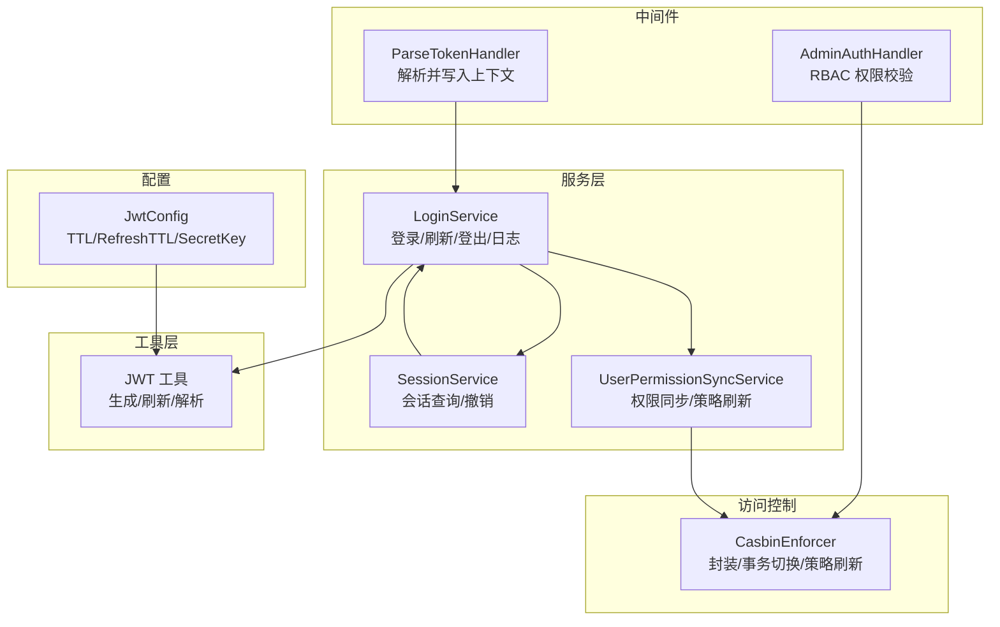
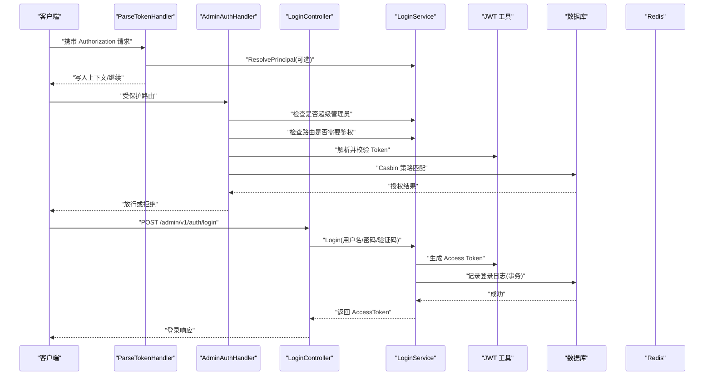
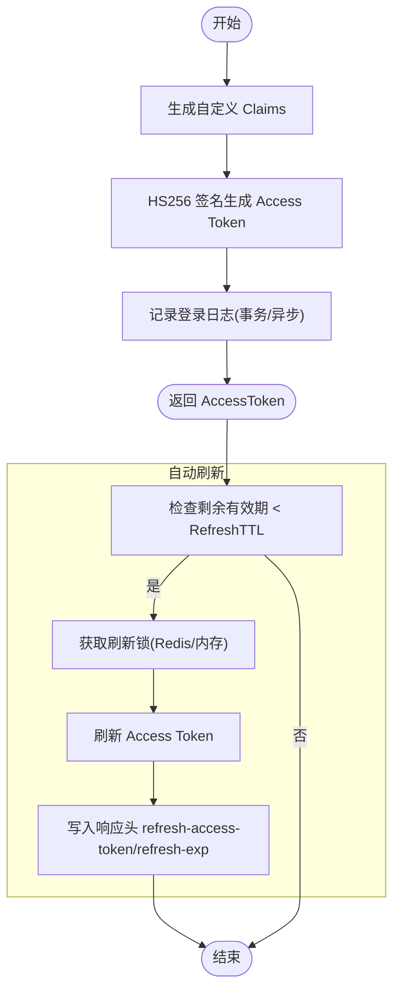
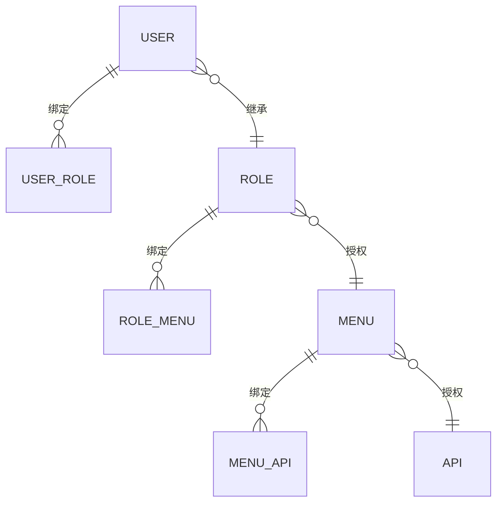
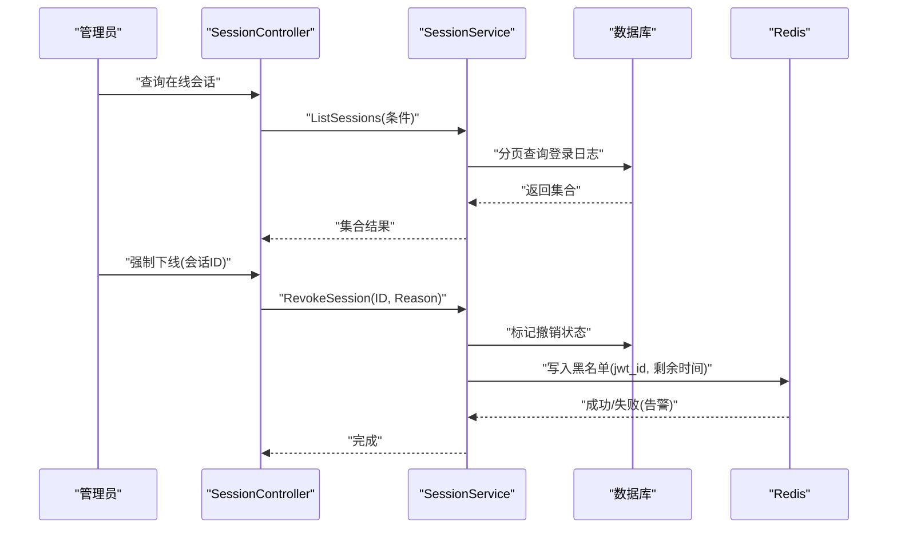
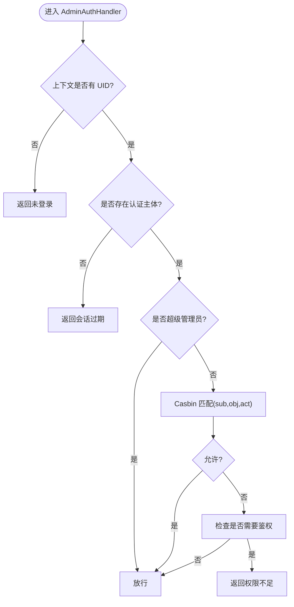
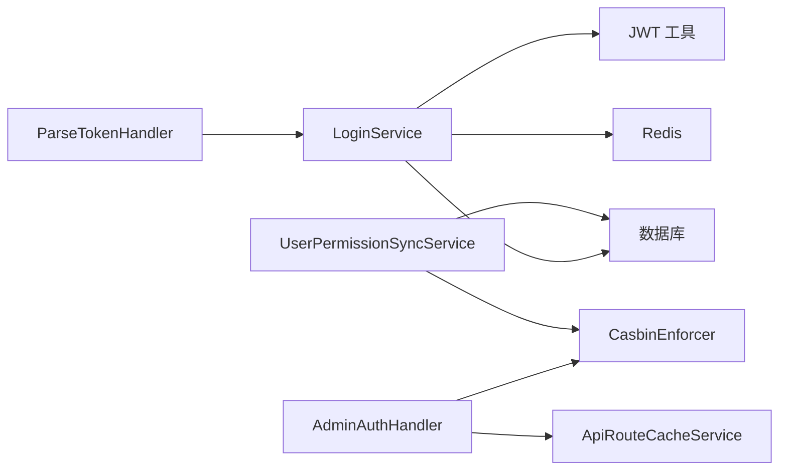

# 认证授权系统

<cite>
**本文引用的文件**
- [internal/middleware/admin_auth.go](file://internal/middleware/admin_auth.go)
- [internal/middleware/parse_token.go](file://internal/middleware/parse_token.go)
- [internal/pkg/utils/token/jwt.go](file://internal/pkg/utils/token/jwt.go)
- [internal/service/auth/login.go](file://internal/service/auth/login.go)
- [internal/service/auth/login_blacklist.go](file://internal/service/auth/login_blacklist.go)
- [internal/service/auth/login_refresh.go](file://internal/service/auth/login_refresh.go)
- [internal/service/auth/session.go](file://internal/service/auth/session.go)
- [internal/service/auth/principal.go](file://internal/service/auth/principal.go)
- [internal/controller/admin_v1/auth.go](file://internal/controller/admin_v1/auth.go)
- [internal/access/casbin/casbin.go](file://internal/access/casbin/casbin.go)
- [internal/service/access/user_permission_sync.go](file://internal/service/access/user_permission_sync.go)
- [internal/service/access/common.go](file://internal/service/access/common.go)
- [rbac_model.conf](file://rbac_model.conf)
- [policy.csv](file://policy.csv)
- [config/autoload/jwt.go](file://config/autoload/jwt.go)
</cite>

## 目录
1. [简介](#简介)
2. [项目结构](#项目结构)
3. [核心组件](#核心组件)
4. [架构总览](#架构总览)
5. [详细组件分析](#详细组件分析)
6. [依赖分析](#依赖分析)
7. [性能考虑](#性能考虑)
8. [故障排查指南](#故障排查指南)
9. [结论](#结论)
10. [附录](#附录)

## 简介
本系统提供一套完整的后台管理认证授权方案，包含：
- 双 Token 认证机制：基于 JWT 的 Access Token 与 Refresh Token（当前实现以 Access Token 为主，Refresh Token 为可选自动刷新能力）
- Casbin RBAC 权限控制：通过模型与策略文件实现细粒度的资源与动作授权
- 会话管理：在线会话查询、强制下线、Token 黑名单与 Redis 去重
- 登录安全策略：验证码、失败次数限制、登录日志异步写入、Redis 黑名单
- 权限同步与缓存：权限变更后批量同步至 Casbin 并刷新内存策略
- 权限中间件：统一鉴权入口，支持超级管理员豁免与路由白名单

## 项目结构
围绕认证授权的关键模块分布如下：
- 中间件层：全局 Token 解析与权限校验
- 服务层：登录、会话、权限同步、Token 黑名单
- 工具层：JWT 生成与解析
- 访问控制层：Casbin 封装与策略管理
- 配置层：JWT 相关参数
- 控制器层：登录、登出、Token 校验等对外接口

图表来源
- [internal/middleware/parse_token.go:1-40](file://internal/middleware/parse_token.go#L1-L40)
- [internal/middleware/admin_auth.go:36-82](file://internal/middleware/admin_auth.go#L36-L82)
- [internal/service/auth/login.go:132-197](file://internal/service/auth/login.go#L132-L197)
- [internal/service/auth/session.go:22-66](file://internal/service/auth/session.go#L22-L66)
- [internal/service/access/user_permission_sync.go:10-36](file://internal/service/access/user_permission_sync.go#L10-L36)
- [internal/pkg/utils/token/jwt.go:31-67](file://internal/pkg/utils/token/jwt.go#L31-L67)
- [internal/access/casbin/casbin.go:13-55](file://internal/access/casbin/casbin.go#L13-L55)
- [config/autoload/jwt.go:5-24](file://config/autoload/jwt.go#L5-L24)

章节来源
- [internal/middleware/parse_token.go:10-39](file://internal/middleware/parse_token.go#L10-L39)
- [internal/middleware/admin_auth.go:36-125](file://internal/middleware/admin_auth.go#L36-L125)
- [internal/service/auth/login.go:132-385](file://internal/service/auth/login.go#L132-L385)
- [internal/service/auth/session.go:22-123](file://internal/service/auth/session.go#L22-L123)
- [internal/service/access/user_permission_sync.go:10-196](file://internal/service/access/user_permission_sync.go#L10-L196)
- [internal/pkg/utils/token/jwt.go:18-118](file://internal/pkg/utils/token/jwt.go#L18-L118)
- [internal/access/casbin/casbin.go:13-81](file://internal/access/casbin/casbin.go#L13-L81)
- [config/autoload/jwt.go:5-24](file://config/autoload/jwt.go#L5-L24)

## 核心组件
- 全局 Token 解析中间件：从请求头提取 Bearer Token，解析并写入上下文，支持可选认证场景
- 权限中间件：校验用户是否为超级管理员，否则通过 Casbin 进行资源与动作匹配
- 登录服务：用户登录、Token 生成、登录日志记录、异步写入、Redis 黑名单写入
- 会话服务：在线会话分页查询、按条件过滤、强制下线（数据库状态+Redis 黑名单）
- 权限同步服务：将用户角色与菜单映射展开为最终接口策略，批量写入 Casbin 并刷新内存策略
- JWT 工具：Access Token 生成/刷新/解析，支持自定义 Claims 结构
- Casbin 封装：单例 Enforcer、事务态 Enforcer 切换、策略重载

章节来源
- [internal/middleware/parse_token.go:17-39](file://internal/middleware/parse_token.go#L17-L39)
- [internal/middleware/admin_auth.go:36-125](file://internal/middleware/admin_auth.go#L36-L125)
- [internal/service/auth/login.go:235-385](file://internal/service/auth/login.go#L235-L385)
- [internal/service/auth/session.go:22-123](file://internal/service/auth/session.go#L22-L123)
- [internal/service/access/user_permission_sync.go:43-121](file://internal/service/access/user_permission_sync.go#L43-L121)
- [internal/pkg/utils/token/jwt.go:31-118](file://internal/pkg/utils/token/jwt.go#L31-L118)
- [internal/access/casbin/casbin.go:29-81](file://internal/access/casbin/casbin.go#L29-L81)

## 架构总览
系统采用“中间件 + 服务 + 工具 + 访问控制”的分层设计，核心流程如下：
- 请求进入：全局 Token 解析中间件尝试解析并写入上下文
- 权限校验：AdminAuthHandler 校验是否为超级管理员，否则调用 Casbin 进行资源/动作匹配
- 登录流程：LoginController 调用 LoginService 登录，生成 Access Token，记录登录日志
- 会话管理：SessionController 调用 SessionService 查询与撤销在线会话
- 权限同步：权限变更后调用 UserPermissionSyncService 批量同步并刷新 Casbin 策略

图表来源
- [internal/middleware/parse_token.go:17-39](file://internal/middleware/parse_token.go#L17-L39)
- [internal/middleware/admin_auth.go:36-125](file://internal/middleware/admin_auth.go#L36-L125)
- [internal/controller/admin_v1/auth.go:27-66](file://internal/controller/admin_v1/auth.go#L27-L66)
- [internal/service/auth/login.go:235-274](file://internal/service/auth/login.go#L235-L274)
- [internal/pkg/utils/token/jwt.go:31-47](file://internal/pkg/utils/token/jwt.go#L31-L47)

## 详细组件分析

### 双 Token 认证机制（JWT Access Token）
- Access Token 生成与解析：使用 HS256 签名，Claims 包含用户基本信息与注册声明（签发人、签发时间、过期时间、唯一 ID 等）
- 刷新策略：支持基于剩余有效期阈值的自动刷新（RefreshTTL），通过分布式锁避免并发刷新冲突
- 登录流程：登录成功后返回 Access Token，记录登录日志（登录类型与刷新类型分别处理）

图表来源
- [internal/pkg/utils/token/jwt.go:31-118](file://internal/pkg/utils/token/jwt.go#L31-L118)
- [internal/service/auth/login_refresh.go:45-153](file://internal/service/auth/login_refresh.go#L45-L153)
- [internal/service/auth/login.go:235-274](file://internal/service/auth/login.go#L235-L274)

章节来源
- [internal/pkg/utils/token/jwt.go:18-118](file://internal/pkg/utils/token/jwt.go#L18-L118)
- [internal/service/auth/login_refresh.go:45-153](file://internal/service/auth/login_refresh.go#L45-L153)
- [internal/service/auth/login.go:235-385](file://internal/service/auth/login.go#L235-L385)

### Casbin RBAC 权限控制与策略管理
- 模型定义：基于 rbac_model.conf 的标准 RBAC 模型，支持角色继承与资源匹配
- 策略数据：policy.csv 展示了用户-角色、角色继承、部门-角色、角色-菜单、菜单-权限的绑定
- 策略加载与刷新：CasbinEnforcer 封装单例与事务态 Enforcer，提供策略重载接口
- 权限同步：UserPermissionSyncService 将用户最终接口权限批量写入 Casbin，并刷新内存策略

图表来源
- [rbac_model.conf:1-14](file://rbac_model.conf#L1-L14)
- [policy.csv:1-30](file://policy.csv#L1-L30)
- [internal/access/casbin/casbin.go:13-81](file://internal/access/casbin/casbin.go#L13-L81)
- [internal/service/access/user_permission_sync.go:43-121](file://internal/service/access/user_permission_sync.go#L43-L121)

章节来源
- [rbac_model.conf:1-14](file://rbac_model.conf#L1-L14)
- [policy.csv:1-30](file://policy.csv#L1-L30)
- [internal/access/casbin/casbin.go:13-81](file://internal/access/casbin/casbin.go#L13-L81)
- [internal/service/access/user_permission_sync.go:43-196](file://internal/service/access/user_permission_sync.go#L43-L196)

### 会话管理、Token 黑名单与多端在线会话控制
- 在线会话查询：支持按用户名、IP、是否撤销、时间范围等条件分页查询
- 强制下线：撤销会话（数据库状态标记）并写入 Redis 黑名单，保留数据库状态作为兜底
- 登出流程：解析 Token，标记撤销，计算剩余有效期并写入 Redis 黑名单
- Redis 黑名单：以 jwt_id 为 key，值为占位符，过期时间等于剩余有效期

图表来源
- [internal/service/auth/session.go:22-123](file://internal/service/auth/session.go#L22-L123)
- [internal/service/auth/login_blacklist.go:27-54](file://internal/service/auth/login_blacklist.go#L27-L54)
- [internal/service/auth/login_blacklist.go:94-157](file://internal/service/auth/login_blacklist.go#L94-L157)

章节来源
- [internal/service/auth/session.go:22-123](file://internal/service/auth/session.go#L22-L123)
- [internal/service/auth/login_blacklist.go:27-213](file://internal/service/auth/login_blacklist.go#L27-L213)

### 权限中间件实现与路由拦截
- 全局 Token 解析：从 Authorization 头提取 Bearer Token，解析并写入上下文，不强制要求
- 权限校验：若非超级管理员，构造 userKey（admin_user:uid）与请求路径、方法进行 Casbin 匹配
- 路由白名单：对于需要鉴权但无权限的情况，依据 ApiRouteCacheService 判断是否返回权限不足

图表来源
- [internal/middleware/admin_auth.go:36-125](file://internal/middleware/admin_auth.go#L36-L125)
- [internal/middleware/parse_token.go:17-39](file://internal/middleware/parse_token.go#L17-L39)

章节来源
- [internal/middleware/admin_auth.go:36-125](file://internal/middleware/admin_auth.go#L36-L125)
- [internal/middleware/parse_token.go:17-39](file://internal/middleware/parse_token.go#L17-L39)

### 登录安全策略与登录日志
- 登录前置校验：用户名锁定、验证码校验、失败次数统计与锁定
- 登录日志：登录成功使用事务同时更新用户最后登录信息与写入登录日志；刷新与失败场景异步写入
- 登出与撤销：登出后将 Token 写入黑名单；撤销会话同样写入黑名单并保留数据库状态

章节来源
- [internal/controller/admin_v1/auth.go:27-99](file://internal/controller/admin_v1/auth.go#L27-L99)
- [internal/service/auth/login.go:235-349](file://internal/service/auth/login.go#L235-L349)
- [internal/service/auth/login_blacklist.go:27-54](file://internal/service/auth/login_blacklist.go#L27-L54)

### 权限同步机制与缓存优化
- 权限同步：收集用户角色与菜单，展开为最终接口策略，批量写入 Casbin
- 事务一致性：在现有事务或新建事务中执行，完成后刷新 Casbin 内存策略
- 批量优化：对用户 ID 去重，复用同一 Enforcer 实例，减少重复获取开销

章节来源
- [internal/service/access/user_permission_sync.go:43-196](file://internal/service/access/user_permission_sync.go#L43-L196)
- [internal/service/access/common.go:9-29](file://internal/service/access/common.go#L9-L29)

## 依赖分析
- 中间件依赖：AdminAuthHandler 依赖 ParseTokenHandler 写入的上下文；依赖 CasbinEnforcer 与 ApiRouteCacheService
- 登录服务依赖：JWT 工具、数据库与 Redis；提供黑名单查询、撤销标记、刷新锁等可插拔依赖
- 权限同步依赖：CasbinEnforcer 封装、GORM 事务、用户角色菜单映射

图表来源
- [internal/middleware/admin_auth.go:22-34](file://internal/middleware/admin_auth.go#L22-L34)
- [internal/service/auth/login.go:155-197](file://internal/service/auth/login.go#L155-L197)
- [internal/service/access/user_permission_sync.go:10-36](file://internal/service/access/user_permission_sync.go#L10-L36)

章节来源
- [internal/middleware/admin_auth.go:22-34](file://internal/middleware/admin_auth.go#L22-L34)
- [internal/service/auth/login.go:155-228](file://internal/service/auth/login.go#L155-L228)
- [internal/service/access/user_permission_sync.go:10-36](file://internal/service/access/user_permission_sync.go#L10-L36)

## 性能考虑
- 登录日志异步写入：使用单 worker 管道队列，避免高并发登录链路被 IO 阻塞
- Casbin 策略批量写入：对用户 ID 去重，复用 Enforcer 实例，减少重复初始化
- 自动刷新锁：优先 Redis 分布式锁，失败降级内存锁，避免并发刷新风暴
- Redis 操作超时：黑名单写入与查询设置超时，失败时保留数据库状态作为兜底

章节来源
- [internal/service/auth/login.go:23-131](file://internal/service/auth/login.go#L23-L131)
- [internal/service/access/user_permission_sync.go:137-162](file://internal/service/access/user_permission_sync.go#L137-L162)
- [internal/service/auth/login_refresh.go:86-132](file://internal/service/auth/login_refresh.go#L86-L132)
- [internal/service/auth/login_blacklist.go:75-110](file://internal/service/auth/login_blacklist.go#L75-L110)

## 故障排查指南
- 未登录/会话过期：AdminAuthHandler 在上下文无 UID 或无认证主体时返回相应错误码
- 权限验证失败：Casbin 初始化失败或匹配异常，返回服务器错误或权限不足
- Redis 不可用：黑名单写入失败时记录告警，数据库撤销状态作为兜底
- 登录失败：检查用户名是否存在、账户状态、密码校验、验证码、失败锁定与日志写入

章节来源
- [internal/middleware/admin_auth.go:50-81](file://internal/middleware/admin_auth.go#L50-L81)
- [internal/middleware/admin_auth.go:98-125](file://internal/middleware/admin_auth.go#L98-L125)
- [internal/service/auth/login_blacklist.go:75-92](file://internal/service/auth/login_blacklist.go#L75-L92)
- [internal/service/auth/login.go:276-296](file://internal/service/auth/login.go#L276-L296)

## 结论
本系统通过中间件、服务、工具与访问控制的清晰分层，实现了可扩展的后台管理认证授权方案。JWT 提供了简洁的 Token 机制，Casbin 实现了灵活的 RBAC 策略，结合会话管理与黑名单，满足多端在线与安全下线需求。权限同步与缓存优化确保了大规模用户场景下的性能与一致性。

## 附录
- 配置项说明（JwtConfig）
  - TTL：Access Token 有效期（秒）
  - RefreshTTL：自动刷新阈值（秒），大于 0 时启用自动刷新
  - SecretKey：JWT 签名密钥，启动时校验非空与强度

章节来源
- [config/autoload/jwt.go:5-24](file://config/autoload/jwt.go#L5-L24)