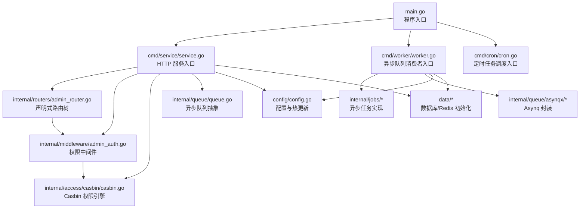
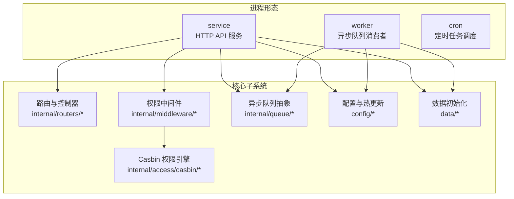
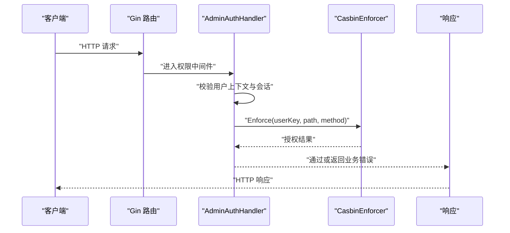
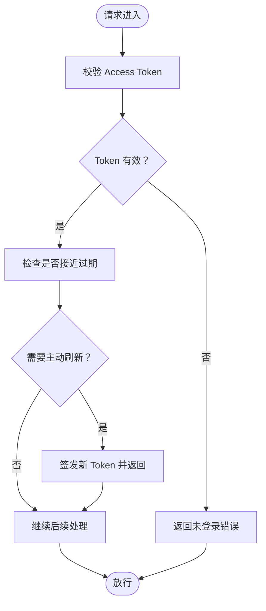
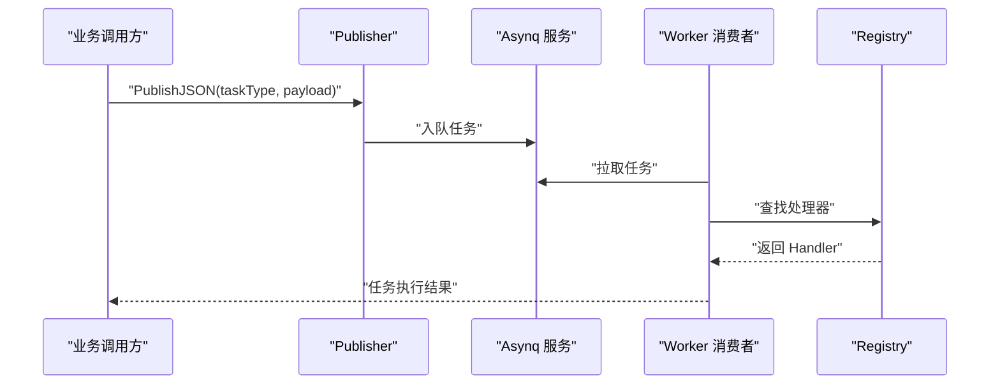
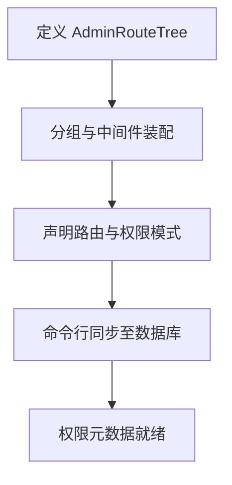
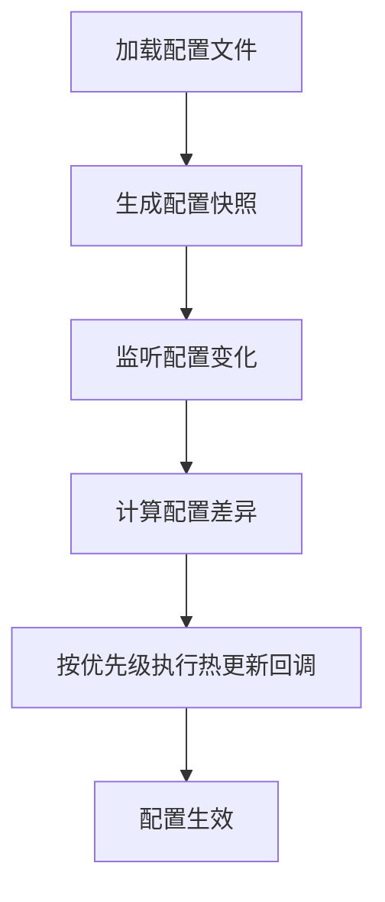
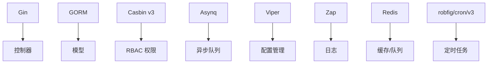

# 项目概述

<cite>
**本文引用的文件**
- [README.md](file://README.md)
- [main.go](file://main.go)
- [go.mod](file://go.mod)
- [config/config.go](file://config/config.go)
- [config/autoload/jwt.go](file://config/autoload/jwt.go)
- [internal/global/auth.go](file://internal/global/auth.go)
- [internal/access/casbin/casbin.go](file://internal/access/casbin/casbin.go)
- [internal/middleware/admin_auth.go](file://internal/middleware/admin_auth.go)
- [internal/queue/queue.go](file://internal/queue/queue.go)
- [cmd/service/service.go](file://cmd/service/service.go)
- [cmd/worker/worker.go](file://cmd/worker/worker.go)
- [internal/routers/admin_router.go](file://internal/routers/admin_router.go)
- [rbac_model.conf](file://rbac_model.conf)
- [policy.csv](file://policy.csv)
- [internal/model/admin_users.go](file://internal/model/admin_users.go)
</cite>

## 目录
1. [引言](#引言)
2. [项目结构](#项目结构)
3. [核心组件](#核心组件)
4. [架构总览](#架构总览)
5. [详细组件分析](#详细组件分析)
6. [依赖分析](#依赖分析)
7. [性能考虑](#性能考虑)
8. [故障排查指南](#故障排查指南)
9. [结论](#结论)
10. [附录](#附录)

## 引言
gin-layout 是一个面向中大型企业级后台场景的 Go 语言后端脚手架，旨在通过统一的工程化架构与能力封装，显著降低中后台系统的基建搭建与维护成本。项目不仅提供登录与基础 RBAC 权限，还在工程化、高可用、任务编排、多存储后端与国际化等方面进行了系统性的规范设计与落地。

其核心价值体现在以下方面：
- 企业级后台管理场景的标准化基座：提供从路由、鉴权、权限、审计、任务到文件存储的一体化能力。
- 双 Token 认证与会话管理：支持 Access Token 与 Refresh Token 的自动刷新、Token 黑名单与多端在线会话管理。
- Casbin v3 RBAC 权限控制：支持管理员、角色、部门（多级树形）、菜单与 API 路由级的细粒度权限控制。
- 异步任务与定时任务中心：统一的任务编排，支持异步任务与定时任务的手动触发、重试、取消与执行记录追踪。
- 高可用审计日志：采用“审计快照 + 异步优先”的设计，结合 Redis/Asynq 队列与降级缓冲，确保高吞吐下的可靠性。
- 文件管理系统：支持本地存储与阿里云 OSS 双驱动，提供直传凭证、分片上传、目录树管理、引用统计与回收站。
- 国际化与配置热更新：基于 Accept-Language 的响应多语言与关键配置的热重载。
- 命令行工具链：覆盖 API 路由同步、权限重建、数据库迁移与系统初始化回滚等运维场景。

## 项目结构
项目采用“命令入口 + 生命周期引导 + 业务子系统”的分层组织方式，核心目录与职责如下：
- cmd：命令与服务引导层，包含 service、worker、cron 等进程入口，以及 bootstrapx 生命周期初始化。
- config：配置项结构定义与示例，支持 Viper 管理与热更新。
- internal：核心业务组件与包，涵盖控制器、中间件、模型、服务、队列、定时任务、文件存储、权限引擎、国际化、审计日志等。
- data：数据库与 Redis 的初始化与健康检查。
- docs：文档与图片资源。
- pkg：通用工具包（可跨项目复用）。
- tests：路由与端到端集成测试集。
- 配置文件：config.yaml.example 与 rbac_model.conf、policy.csv 等。

图表来源
- [main.go:1-10](file://main.go#L1-L10)
- [cmd/service/service.go:1-121](file://cmd/service/service.go#L1-L121)
- [cmd/worker/worker.go:1-75](file://cmd/worker/worker.go#L1-L75)
- [internal/routers/admin_router.go:1-363](file://internal/routers/admin_router.go#L1-L363)
- [internal/middleware/admin_auth.go:1-126](file://internal/middleware/admin_auth.go#L1-L126)
- [internal/access/casbin/casbin.go:1-81](file://internal/access/casbin/casbin.go#L1-L81)
- [internal/queue/queue.go:1-413](file://internal/queue/queue.go#L1-L413)
- [config/config.go:1-120](file://config/config.go#L1-L120)

章节来源
- [README.md:161-194](file://README.md#L161-L194)
- [main.go:1-10](file://main.go#L1-L10)
- [go.mod:1-118](file://go.mod#L1-L118)

## 核心组件
- 双 Token 认证与会话管理
  - JWT 配置项：TTL、RefreshTTL、SecretKey，支持 Token 自动刷新与主动刷新阈值控制。
  - 会话与 Token 黑名单：支持多端在线会话管理与 Token 失效控制。
- Casbin v3 RBAC 权限控制
  - 基于模型与策略文件，支持用户-角色、角色-部门、菜单-权限的多维授权。
  - 权限校验在中间件中完成，路径与方法匹配规则由模型定义。
- 声明式路由与 API 元数据
  - 通过 AdminRouteTree() 生成 Gin 路由与 API 权限元数据，一键同步至数据库。
- 高可用审计日志
  - 审计快照 + 异步优先 + 降级缓冲（fallbackBuffer）+ 同步写入兜底，保障高吞吐可靠性。
- 文件管理系统
  - 本地存储与阿里云 OSS 双驱动，支持直传凭证、分片上传、目录树、引用统计、逻辑删除与回收站。
- 任务与定时中心
  - 统一的任务编排，支持异步任务与定时任务，提供手动触发、重试、取消与执行记录追踪。
- 国际化与配置热更新
  - 基于 Accept-Language 的响应多语言与关键配置热重载。
- 命令行工具链
  - 覆盖 API 路由同步、权限重建、数据库迁移与系统初始化回滚等运维场景。

章节来源
- [README.md:29-48](file://README.md#L29-L48)
- [config/autoload/jwt.go:1-25](file://config/autoload/jwt.go#L1-L25)
- [rbac_model.conf:1-14](file://rbac_model.conf#L1-L14)
- [policy.csv:1-30](file://policy.csv#L1-L30)
- [internal/routers/admin_router.go:1-363](file://internal/routers/admin_router.go#L1-L363)

## 架构总览
gin-layout 的运行形态支持四种主命令进程，可按需独立部署：
- service：启动 HTTP API 服务，承载控制器、中间件、权限校验与业务编排。
- worker：启动异步队列消费者，处理异步任务与可选的定时任务回退处理。
- cron：启动定时任务调度服务（独立模块，入口文件存在）。
- bootstrapx：统一的生命周期初始化，负责数据库、配置、Redis 等组件的准备。

图表来源
- [cmd/service/service.go:1-121](file://cmd/service/service.go#L1-L121)
- [cmd/worker/worker.go:1-75](file://cmd/worker/worker.go#L1-L75)
- [internal/routers/admin_router.go:1-363](file://internal/routers/admin_router.go#L1-L363)
- [internal/middleware/admin_auth.go:1-126](file://internal/middleware/admin_auth.go#L1-L126)
- [internal/access/casbin/casbin.go:1-81](file://internal/access/casbin/casbin.go#L1-L81)
- [internal/queue/queue.go:1-413](file://internal/queue/queue.go#L1-L413)
- [config/config.go:1-120](file://config/config.go#L1-L120)

## 详细组件分析

### 权限中间件与 Casbin 集成
权限中间件在 Gin 请求链路中完成用户上下文校验与 API 权限判断：
- 依赖 ParseTokenHandler 预先写入用户上下文。
- 非超级管理员用户通过 Casbin 进行权限校验，路径与方法匹配由模型定义。
- 对未授权的 API 路由返回明确的业务错误码与消息键。

图表来源
- [internal/middleware/admin_auth.go:36-126](file://internal/middleware/admin_auth.go#L36-L126)
- [internal/access/casbin/casbin.go:39-81](file://internal/access/casbin/casbin.go#L39-L81)
- [rbac_model.conf:1-14](file://rbac_model.conf#L1-L14)

章节来源
- [internal/middleware/admin_auth.go:1-126](file://internal/middleware/admin_auth.go#L1-L126)
- [internal/access/casbin/casbin.go:1-81](file://internal/access/casbin/casbin.go#L1-L81)
- [rbac_model.conf:1-14](file://rbac_model.conf#L1-L14)
- [policy.csv:1-30](file://policy.csv#L1-L30)
- [internal/global/auth.go:1-13](file://internal/global/auth.go#L1-L13)

### 双 Token 认证与会话管理
- JWT 配置项：TTL、RefreshTTL、SecretKey，支持 Token 自动刷新与主动刷新阈值控制。
- 会话与 Token 黑名单：支持多端在线会话管理与 Token 失效控制。
- 会话撤销与在线列表：提供会话管理接口，支持管理员维度的会话治理。

图表来源
- [config/autoload/jwt.go:1-25](file://config/autoload/jwt.go#L1-L25)
- [internal/routers/admin_router.go:114-122](file://internal/routers/admin_router.go#L114-L122)

章节来源
- [config/autoload/jwt.go:1-25](file://config/autoload/jwt.go#L1-L25)
- [internal/routers/admin_router.go:104-122](file://internal/routers/admin_router.go#L104-L122)

### 异步队列与任务中心
- 任务抽象：Job、Registry、Publisher、Inspector 统一任务发布与控制。
- JSON 任务：提供 JSONPayload 的通用任务封装与校验。
- Asynq 集成：worker 进程通过 Asynq Server 消费任务，支持并发、优先级与队列配置。
- 任务中心：提供任务定义、手动触发、重试、取消与执行记录追踪。

图表来源
- [internal/queue/queue.go:133-162](file://internal/queue/queue.go#L133-L162)
- [cmd/worker/worker.go:53-67](file://cmd/worker/worker.go#L53-L67)

章节来源
- [internal/queue/queue.go:1-413](file://internal/queue/queue.go#L1-L413)
- [cmd/worker/worker.go:1-75](file://cmd/worker/worker.go#L1-L75)

### 声明式路由与 API 元数据
- AdminRouteTree() 定义了管理员后台的路由树，包含公开接口、登录、通知、仪表盘、通用、认证、用户、权限、菜单、角色、部门、系统、日志与任务中心等分组。
- 路由注册与权限元数据同步：通过命令行工具将声明式路由同步至数据库，形成 API 权限表。

图表来源
- [internal/routers/admin_router.go:20-79](file://internal/routers/admin_router.go#L20-L79)
- [README.md:108-125](file://README.md#L108-L125)

章节来源
- [internal/routers/admin_router.go:1-363](file://internal/routers/admin_router.go#L1-L363)
- [README.md:108-125](file://README.md#L108-L125)

### 配置与热更新
- 配置结构：App、Mysql、Redis、Logger、Jwt、Queue 等。
- 热更新机制：支持 Logger、Mysql、Redis、CORS、JWT TTL/RefreshTTL 等关键配置的运行时热重载。
- 注册与排序：通过注册热更新回调并按优先级排序，确保更新顺序可控。

图表来源
- [config/config.go:12-120](file://config/config.go#L12-L120)

章节来源
- [config/config.go:1-120](file://config/config.go#L1-L120)
- [README.md:128-144](file://README.md#L128-L144)

### 文件存储与直传
- 存储驱动：本地存储与阿里云 OSS 双驱动，支持直传凭证（单/多）、分片上传、目录树管理、文件引用统计、逻辑删除与回收站。
- 适用场景：大文件上传、CDN 分发、多租户隔离与合规删除。

章节来源
- [README.md:43-44](file://README.md#L43-L44)

### 国际化与审计日志
- 国际化：基于 Accept-Language 自动处理响应错误多语言，支持菜单标题的国际化持久化。
- 审计日志：采用“审计快照 + 异步优先 + 降级缓冲 + 同步写入兜底”的设计，确保高吞吐下的可靠性。

章节来源
- [README.md:45-46](file://README.md#L45-L46)

## 依赖分析
项目的技术选型与依赖关系体现了工程化与高可用的设计思路：
- Web 框架：Gin，提供高性能 HTTP 服务。
- ORM：GORM，支持多数据库与软删除插件。
- 权限：Casbin v3 + GORM 适配器，提供灵活的 RBAC 模型。
- 队列：Asynq，支持任务优先级、并发与重试。
- 配置：Viper，支持配置热更新与多源加载。
- 日志：Zap，高性能日志库。
- 缓存：Redis，支持队列、会话与缓存。
- 定时任务：robfig/cron/v3，与 Asynq 协同。
- 工具库：spf13/cobra（CLI）、spf13/viper（配置）、google/uuid（ID）、mime 类型识别等。

图表来源
- [go.mod:5-38](file://go.mod#L5-L38)

章节来源
- [go.mod:1-118](file://go.mod#L1-L118)

## 性能考虑
- 高吞吐与可靠性：审计日志采用异步优先与降级缓冲，避免阻塞主请求链路。
- 队列与并发：Asynq 支持并发与优先级配置，合理分配任务资源。
- 缓存与连接池：Redis 与数据库连接池按配置动态重建，避免频繁重启带来的抖动。
- 路由与中间件：声明式路由与权限中间件在编译期与启动期完成元数据同步，运行期仅做快速匹配。

## 故障排查指南
- 权限校验失败
  - 确认用户上下文是否正确写入，检查 Casbin Enforcer 初始化与策略加载。
  - 核对 rbac_model.conf 与 policy.csv 的匹配规则。
- 配置热更新异常
  - 检查热更新回调注册与优先级排序，确认变更字段是否在支持列表内。
- 队列不可用
  - 确认 Queue.Enable 与 Redis 配置，检查 Asynq Server 启动日志与任务注册。
- 会话与 Token 问题
  - 检查 JWT 配置（TTL、RefreshTTL、SecretKey），核对 Token 刷新阈值与黑名单策略。

章节来源
- [internal/middleware/admin_auth.go:89-126](file://internal/middleware/admin_auth.go#L89-L126)
- [config/config.go:50-120](file://config/config.go#L50-L120)
- [internal/queue/queue.go:221-287](file://internal/queue/queue.go#L221-L287)
- [config/autoload/jwt.go:1-25](file://config/autoload/jwt.go#L1-L25)

## 结论
gin-layout 通过统一的架构模式与工程化能力封装，为企业级后台管理提供了高可用、可扩展、易维护的脚手架基座。其双 Token 认证、Casbin RBAC、异步与定时任务中心、高可用审计日志、文件存储与国际化等特性，能够满足复杂后台系统的多样化需求。配合完善的 CLI 工具链与配置热更新机制，项目在开发效率与运维稳定性之间实现了良好平衡。

## 附录
- 快速开始与命令行指南：参考项目 README 的“快速开始”与“命令行命令指南”章节，涵盖环境要求、安装、配置、迁移与启动服务等步骤。
- 目录结构设计：README 的“目录结构设计”章节提供了清晰的目录与职责说明，便于理解整体架构。

章节来源
- [README.md:51-125](file://README.md#L51-L125)
- [README.md:161-194](file://README.md#L161-L194)